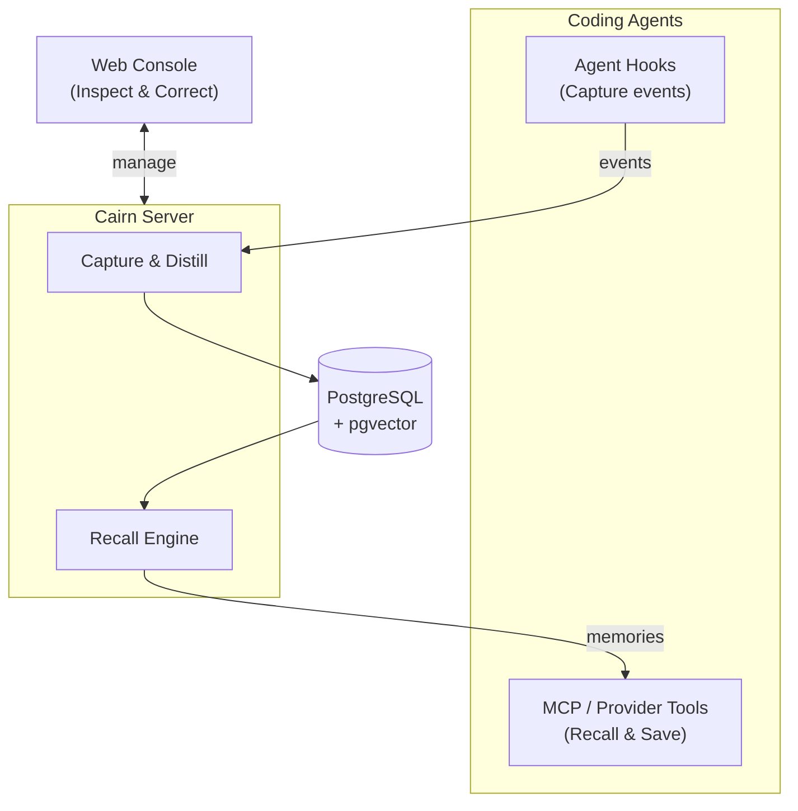

# Shared memory for coding agents

Persistent, self-hosted memory service for coding agents: capture verified work, distill knowledge across sessions, and inspect records via web console.

*Flow: Agent hooks capture developer activity, background jobs distill durable records into PostgreSQL, recall serves relevant memories to agents, and humans inspect or correct knowledge in the web console.*

Agent hooks capture prompts, edits, and tool results. Cairn stores durable memories and automatically delivers relevant context to later sessions. Teams review, vote on, and correct records in the web console.
