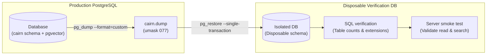

# Backup and restore

Create consistent PostgreSQL database dumps and verify disaster recovery drills on disposable targets.



*Backup and restore cycle: Production database is dumped with custom format, restored to an isolated disposable database inside a single transaction, verified with count queries, and smoke tested.*

## Create a backup

Always dump the full database before applying server upgrades:

```sh title="Shell"
umask 077
pg_dump --format=custom --file=cairn.dump --dbname='service=cairn-source'
pg_restore --list cairn.dump
```

- **Scope**: Includes accounts, device tokens, projects, memories, embeddings, links, and background jobs.
- **Security**: Contains hashed credentials and secrets; protect dump permissions (`umask 077`).

## Practice on a disposable target

Test disaster recovery drills against an isolated, empty PostgreSQL database:

```sh title="Shell"
pg_restore --exit-on-error --single-transaction --no-owner --no-privileges \
  --dbname='service=cairn-drill' cairn.dump
```

### Verify the restore

Run SQL checks against the restored database to confirm schema version and record counts:

```sql title="Verify the restore"
SELECT extversion FROM pg_extension WHERE extname = 'vector';
SELECT version FROM cairn.schema_version ORDER BY version;
SELECT count(*) FROM cairn.projects;
SELECT count(*) FROM cairn.memories;
```

Verify that counts match production, start a test server pointing to the drill database, and confirm search operations resolve expected records.

See [Deployment variables](deployment.md#environment), [Startup migrations](data-model.mdx#startup-migrations), and [Upgrade guide](../users/upgrade.md).
