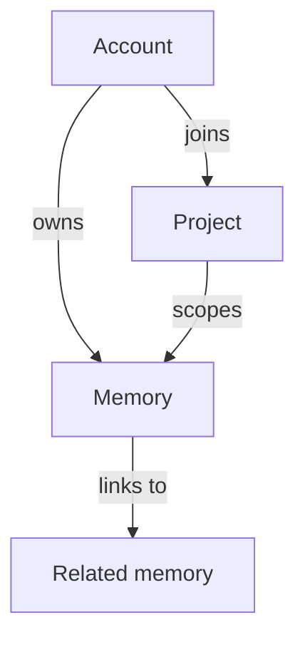

# Data model and migrations

PostgreSQL holds the authoritative store. Cairn defaults to the `cairn` schema, and installs the `vector` extension in `public`. The selected schema holds accounts, projects and memberships, memories and links, capture records, and worker state. Device outboxes bridge temporary delivery failures.

## Owners, members and records

An account owns its devices and memories. The pair `project_id, person_id` identifies membership, including the owner's membership. A project-scoped memory points to the project. Both ends of a link refer to memory IDs. A capture belongs to a session keyed by person and session ID.

| Records | Keys and purpose |
| --- | --- |
| `accounts`, `devices`, `web_sessions` | Stable IDs identify accounts and credentials. Passwords and bearer tokens are stored as hashes. The database enforces a single administrator. |
| `projects`, `project_members` | The committed project ID identifies a project. Membership joins the project to an account. |
| `memories`, `links` | `memory_id` identifies the record. A link uses the source ID, target ID and relation as its key. Explicit corrections preserve the replaced record and link back to it. |
| `entities`, `memories.embedding`, `memory_aliases` | Derived entity names, 384-dimensional vectors and alternate phrasings support retrieval. The main search document is a generated PostgreSQL full-text column on the memory. |
| `usage`, `usage_votes`, `session_shown` | Counters, votes and the per-person session ledger record retrieval usage and feedback. |
| `sessions`, `observations` | A session is keyed by person and session ID. Observations are keyed by person and event ID so a repeated delivery can be deduplicated. |
| `jobs`, `schema_version` | Durable jobs record claims and their outcomes. The migration ledger records applied version names and timestamps. |
| `skills`, `skill_versions`, `skill_votes` | Skills are global. New versions preserve earlier text. A person's vote applies to one version. |

Visibility follows scope, owner and membership. Archived projects keep memberships and memory IDs and are omitted from agent retrieval. A Hermes chat route further restricts chat-tagged personal memory. Raw observations never appear in memory search. They expire after 30 days, and distilled captures can be removed after seven days. Finished jobs and the automatic recall ledger also have separate retention. Stale and superseded memories remain searchable with a label, and age alone does not hide a memory. [Scopes](../users/memory/scopes.md) · [Processing](processing.md).

## Startup migrations

The store checks for the legacy `public.cairn_memories` table and refuses that pre-0.1.6 database. It creates the selected schema and `vector` extension, then walks the compiled list of SQL files. Each unapplied version runs in a transaction with a PostgreSQL advisory lock. Recording the version and applying its SQL commit together. Already applied versions are skipped. Provision a database with pgvector available and the permissions to initialize the store.

Write additive migrations with backfills for existing rows so users keep their data across upgrades. Keep applied files intact. The release notes list compatibility boundaries, including when a fresh database is required. [Migration rules](contributing.md#migrations) · [SQL migrations](https://github.com/cunilab/cairn-memory/tree/main/migrations) · [Startup code](../../../../crates/store/src/lib.rs) · [Release notes](../users/releases/index.md).
