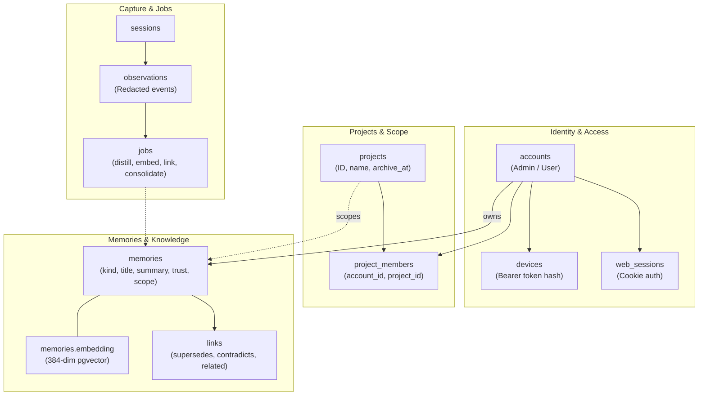

# Data model and migrations

PostgreSQL schema, entity relationships, visibility boundaries, and transactional startup migrations.

PostgreSQL is the authoritative store. Cairn isolates tables in the `cairn` schema and installs the `vector` extension in `public`.

*Entity relationships: Accounts own devices and project memberships; projects scope shared memories; memories hold vector embeddings and link relations; capture sessions distill into background jobs.*

## Owners, members and records

| Record tables | Primary keys and purpose |
| --- | --- |
| `accounts`, `devices`, `web_sessions` | Identity and credentials. Passwords and bearer tokens stored as Argon2 / SHA-256 hashes. Single admin enforced. |
| `projects`, `project_members` | Project registration and membership join table (`project_id`, `person_id`). |
| `memories`, `links` | `memory_id` identifies knowledge. Links join source and target IDs with a relation (`supersedes`, `contradicts`, `related`). |
| `entities`, `memories.embedding`, `memory_aliases` | Extracted symbols/commands, 384-dimensional MiniLM vectors, and derived search aliases. |
| `usage`, `usage_votes`, `session_shown` | Retrieval usage counters, user feedback votes, and per-session automatic recall ledgers. |
| `sessions`, `observations` | Capture event store keyed by person and session ID. Deduplicated by event ID. Expire after 30 days. |
| `jobs`, `schema_version` | Transactional job queue claims and applied migration history ledger. |
| `skills`, `skill_versions`, `skill_votes` | Global procedural skill library with immutable revision history. |

## Startup migrations

At boot, the server acquires a PostgreSQL advisory lock, checks for legacy pre-0.1.6 tables, ensures `vector` extension availability, and runs unapplied SQL files from `migrations/` in individual transactions.

### Migration rules

- **Additive changes**: New columns must be nullable or supply sensible defaults. Backfills must be idempotent.
- **No destructive SQL**: `DROP`, `TRUNCATE`, and column drops are blocked by CI unless explicitly allowlisted in `migrations/destructive-allowlist.txt`.
- Applied migration files are immutable.

See [Migration rules](contributing.md#migrations), [Scopes](../users/memory/scopes.md), and [Processing](processing.md).
