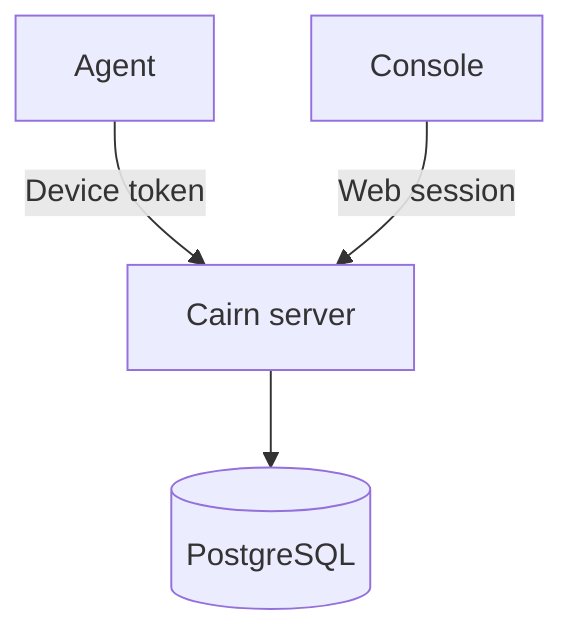
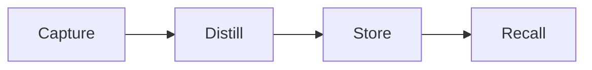

# Architecture — Cairn Memory

Cairn is a self-hosted memory service for coding agents. A Rust server manages authoritative state in PostgreSQL with pgvector. Agents interact via CLI, hooks, and MCP over [device-authenticated](../glossary.md#device-token) HTTP; humans inspect and manage records through the web console.

## Components

| Component | Architecture role | Key responsibilities |
| --- | --- | --- |
| `cairn-core` | Pure domain library | Data models, quality validation, secret redaction, token budgets. Zero external I/O. |
| `cairn-store` | Database abstraction | PostgreSQL 17 + pgvector queries, advisory-locked migrations, job transactions. |
| `cairn-server` | HTTP API service | REST router (`/cairn-memory/*`), authentication, background processing workers. |
| `cairn-client` | Client binary | `cairn` CLI, `cairn mcp` stdio server, agent hooks, and bounded local [outbox](../glossary.md#outbox). |
| `apps/web` | Browser console | Next.js web application for accounts, devices, memories, skills, and admin fixes. |

## Main flows

- Hooks redact secrets and clip events before storing observations. Checkpoints and session end enqueue [distillation](processing.md#session-handoffs-and-distillation).
- Explicit saves validate quality and kind-specific fields before storage. New and revised memories can enqueue embedding and link jobs.
- [Retrieval](retrieval.md) filters by visibility, combines evidence across channels, and returns relevant records within a token budget.

## Decisions and why

- **Single admin model**: The initial account created during bootstrap is the sole administrator.
- **Project membership via file**: Possessing `.cairn/project.json` grants membership; Git remotes alone do not grant access.
- **Additive migrations**: Applied migrations are never edited in place; all schema modifications must be backward-compatible with backfills.
- **Embedded vector model**: Uses `all-MiniLM-L6-v2` locally inside the server process; avoids external LLM runtime costs.
- **Brief and recall budgeting**: Extended session briefs split 1,800 bytes evenly between L0 (personal and project pins split 50/50 with spillover and an explicit `"N more pinned not shown"` notice on overflow) and L1 (handoffs, personal preferences and rules, and project essentials); brief cards record in `session_shown` for deduplication and usage without spending the 8-card L2 contextual budget.
- **Trunk-based release**: Main is always releasable; published releases use immutable signed tags and multi-arch container images.
