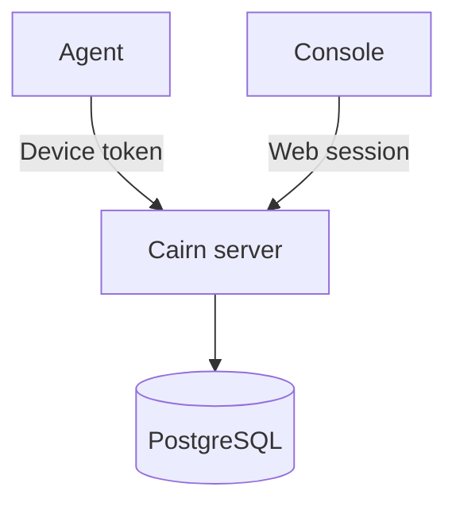
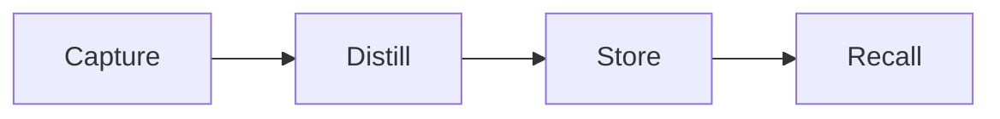

# Architecture — Cairn Memory

Cairn is a self-hosted memory service for coding agents. A Rust server manages authoritative state in PostgreSQL with pgvector. Agents interact via CLI, hooks, and MCP over [device-authenticated](../glossary.md#device-token) HTTP; humans inspect and manage records through the web console.

## Components

| Component | Architecture role | Key responsibilities |
| --- | --- | --- |
| `cairn-core` | Pure domain library | Data models, quality validation, secret redaction, token budgets. Zero external I/O. |
| `cairn-store` | Database abstraction | PostgreSQL 17 + pgvector queries, advisory-locked migrations, job transactions. |
| `cairn-server` | HTTP API service | REST router (`/cairn-memory/*`), authentication, background processing workers. |
| `cairn-client` | Client binary | `cairn` CLI, `cairn mcp` stdio server, agent hooks, and bounded local [outbox](../glossary.md#outbox). |
| `apps/web` | Browser console | Next.js web application for accounts, devices, memories, skills, and admin fixes. |

## Main flows

- Hooks redact secrets and clip events before storing observations. Checkpoints and session end enqueue [distillation](processing.md#session-handoffs-and-distillation).
- Explicit saves validate quality and kind-specific fields before storage. New and revised memories can enqueue embedding and link jobs.
- [Retrieval](retrieval.md) filters by visibility, combines evidence across channels, and returns relevant records within a token budget.

## Decisions and why

- **Single admin model**: The initial account created during bootstrap is the sole administrator.
- **Project membership via file**: Possessing `.cairn/project.json` grants membership; Git remotes alone do not grant access.
- **Additive migrations**: Applied migrations are never edited in place; all schema modifications must be backward-compatible with backfills.
- **Embedded vector model**: Uses `all-MiniLM-L6-v2` locally inside the server process; avoids external LLM runtime costs.
- **Brief and recall budgeting**: Extended session briefs split 1,800 bytes evenly between L0 (personal and project pins split 50/50 with spillover and an explicit `"N more pinned not shown"` notice on overflow) and L1 (handoffs, personal preferences and rules, and project essentials). L0 walks each bucket by `pin_position`, then memory id. Brief cards record in `session_shown` for deduplication and usage without spending the 8-card L2 contextual budget.
- **Session provenance**: `memory_sessions` links a memory to a session only when that save or distill created the row. A missing session, a duplicate save, and every memory written before this change stay unlinked. The console shows "Saved in" only when the viewer can see both the memory and the session. Chat sessions stay visible to their owner. The time-window `agent_saves` count is still an estimate, not a citation.
- **Pin order and project pin permission**: Personal and project pins keep an integer `pin_position`. New pins append. Unpin leaves gaps. Reorder replaces the whole bucket under the existing pin advisory lock and returns 409 when the set or any position differs. Personal pins stay owner-only. A project pin can be pinned, unpinned, or reordered by the memory owner (while a member), the project owner, or the server admin. Archived projects stay read-only. Superseded memories still cannot be newly pinned.
- **Trunk-based release**: Main is always releasable; published releases use immutable signed tags and multi-arch container images.
- **Search card why and narrow get**: A search card may include `why` (the channels, and a file, symbol, command or error when one matched). `memory_get` accepts optional `field` (one fields key, `reason`, or `detail`) and `timeline` (at most six memories on the supersedes chain). Both apply to one id. A memory the caller cannot read is absent from the chain. Older clients omit the new arguments and still receive the full record.
- **Explicit identifier search**: Explicit search keeps the original query for the relevance gate and adds snake_case, camelCase and path-stem parts only to the lexical partial-match leg. Quoted phrases, version numbers and error lines are not split. Hooks do not use that expansion. Equal scores then prefer an exact symbol, path or error, then agreement across the lexical, entity and semantic channels. A memory is packed once. No trigram index.
- **Console browse**: The web memories list uses `GET /cairn-memory/console/memories` (web session only). Exact match is a case-insensitive NFC substring of one field (title, summary, reason, detail, or a single fields value). Related keeps the English full-text ranking. Pages are numbered (`page`, `page_size` 25/50/100, `total`) and share one read snapshot. Pin quotas stay 3 personal and 4 per project. The older `GET /memories` cursor list and `POST /search` are unchanged.
- **Web detail edits**: Administrators set detail from the memory rewrite form. The server redacts it and enforces the same 8,000-character limit as an agent save. An omitted detail keeps the stored text; an empty detail clears it on the new version. Every rewrite, including a detail-only edit, supersedes. The previous version keeps its detail. The successor takes the identity slot so later saves still match the current version. Agents still receive detail only from `memory_get` with `detail: true`.
