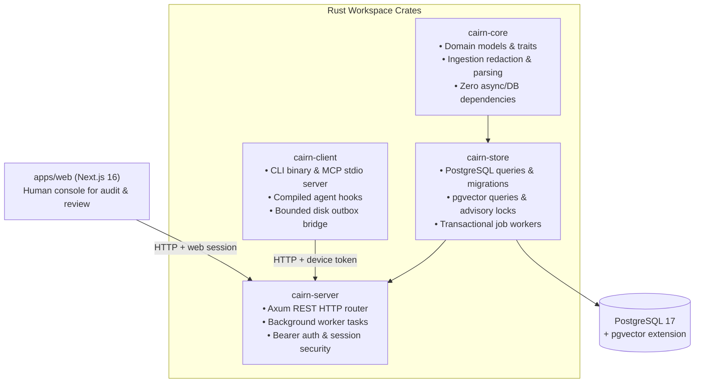
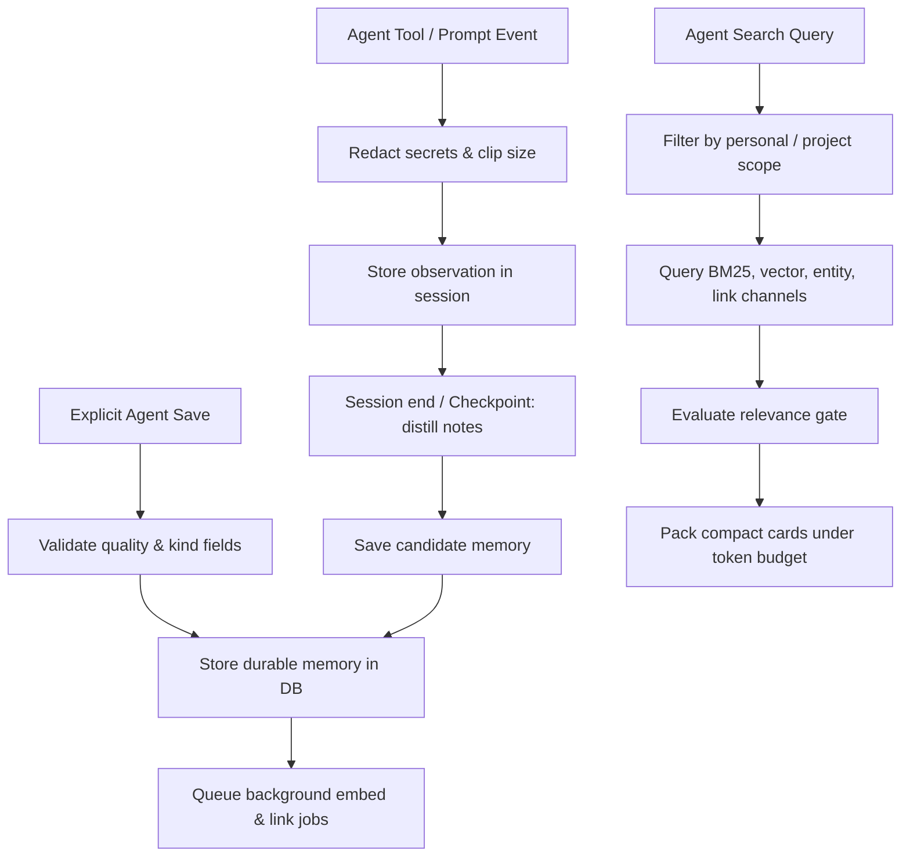

# Architecture — Cairn Memory

System topology, Rust crate responsibilities, data flow, and key architectural decisions.

Cairn is a self-hosted memory service for coding agents. A Rust server manages authoritative state in PostgreSQL with pgvector. Agents interact via CLI, hooks, and MCP over device-authenticated HTTP; humans inspect and manage records through the web console.

*Crate dependency hierarchy: cairn-core contains pure logic; cairn-store manages PostgreSQL; cairn-server serves REST endpoints; cairn-client and apps/web communicate strictly over HTTP.*

## Components

| Component | Architecture role | Key responsibilities |
| --- | --- | --- |
| `cairn-core` | Pure domain library | Data models, quality validation, secret redaction, token budgets. Zero external I/O. |
| `cairn-store` | Database abstraction | PostgreSQL 17 + pgvector queries, advisory-locked migrations, job transactions. |
| `cairn-server` | HTTP API service | REST router (`/cairn-memory/*`), authentication, background processing workers. |
| `cairn-client` | Client binary | `cairn` CLI, `cairn mcp` stdio server, agent hooks, and resilient local outbox. |
| `apps/web` | Browser console | Next.js web application for accounts, devices, memories, skills, and admin fixes. |

## Main flows

*Data flow: Hooks capture developer actions, workers distill observations into durable memories, and the hybrid retrieval engine serves relevant context back to agents.*

## Decisions and why

- **Single admin model**: The initial account created during bootstrap is the sole administrator.
- **Project membership via file**: Possessing `.cairn/project.json` grants membership; Git remotes alone do not grant access.
- **Additive migrations**: Applied migrations are never edited in place; all schema modifications must be backward-compatible with backfills.
- **Embedded vector model**: Uses `all-MiniLM-L6-v2` locally inside the server process; avoids external LLM runtime costs.
- **Trunk-based release**: Main is always releasable; published releases use immutable signed tags and multi-arch container images.
