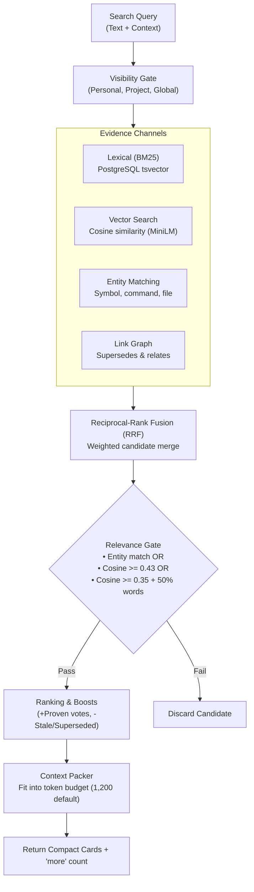

# Retrieval and ranking

Multi-channel evidence fusion, relevance thresholds, trust ranking, and token packing algorithms.

*Retrieval pipeline: Queries filter by visibility, gather evidence across four channels, fuse via RRF, filter through a relevance gate, adjust by trust rating, and pack within token limits.*

## Hybrid recall

Search applies visibility filters before querying candidate channels:

- **Lexical channel**: PostgreSQL full-text search using English stemming.
- **Vector channel**: 384-dimensional cosine similarity via pgvector and local `all-MiniLM-L6-v2`.
- **Entity channel**: Exact matches on symbol names, file paths, and command signatures.
- **Link channel**: Traversing `supersedes` and relationship edges.
- **Relevance gate**: Requires:
  1. An exact entity hit, OR
  2. Cosine similarity ≥ 0.43, OR
  3. Lexical coverage ≥ 50% with cosine similarity ≥ 0.35.

## Automatic recall evidence

| Trigger | Search criteria | Priority & limits |
| --- | --- | --- |
| **File topics** | Matches edited or read file paths, module names, or symbols | Rules & Gotchas > Decisions > Facts & Procedures. Up to 4 cards of 300 bytes. |
| **Command warnings** | Exact normalized command entity (first 3 words before `\|`, `&&`, `;`) | Up to 2 gotchas or procedures once per command per session. |
| **Failed command** | Error line in last 2 KiB output + command entity | Gotchas precede procedures. Matches error signature with ≥ 3 lexemes. |
| **Prompt recall** | Hybrid search for prompts ≥ 4 words (relevance ≥ 0.60) | Up to 2 memory cards and 1 skill card within 300 bytes total. |

See [Recall layers and packing limits](../users/memory/layers.md#automatic-recall) and [MCP result contracts](../users/reference/mcp.md#results).
