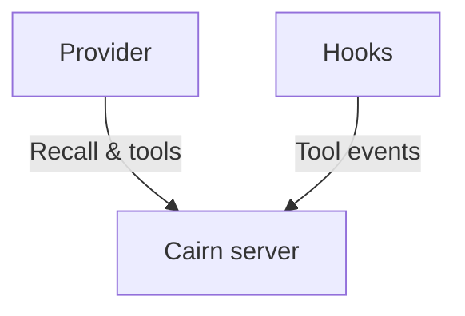

# Hermes Agent

Hermes connects to Cairn through a native [memory provider](../../glossary.md#provider) and separate [plugin hooks](../../glossary.md#hook).



The provider prefetches at turn start and supplies native tools. Hermes cannot extend a finished turn, so after a turn that edited files, Cairn's one save reminder arrives with your next prompt. The plugin captures tool activity and returns failed-command warnings. A coding checkout uses project and personal memory. A [gateway profile](hermes-gateway.md) can also keep chat-tagged personal memories.

## Check the Hermes version

Cairn requires **Hermes v2026.4.23 or newer**:
- v2026.4.16 lacks `transform_tool_result`, preventing failed-command recall.
- Releases prior to v2026.4.16 cannot load external memory providers.
- `cairn setup` and `cairn doctor` verify `__release_date__` in `hermes_cli/__init__.py`.

## Connect a profile

Target the default profile (or specify `HERMES_HOME=/path/to/profile`):

```sh
cairn setup https://cairn.example.com --agent hermes
cairn doctor
```

Start Hermes again after setup. Newer Hermes runs CLI and TUI chats in the profile's shared gateway process (`hermes gateway run`, started on demand). If that process was running during setup, start it again too: until then it keeps Cairn's tools but skips tool capture and failed-command recall. `cairn doctor` and `hermes memory status` read the profile's files only.

Verify provider and plugin discovery after restarting Hermes:

```sh
hermes memory status
hermes plugins list
```

- **Memory provider**: Updates `config.yaml` to set `memory.provider: cairn-memory`.
- **Plugin enabled**: Enables `plugins/cairn-memory/` in `plugins.enabled`.
- **Instruction**: Adds a managed instruction block to `SOUL.md`.
- **Native tools**: The provider supplies memory and skill tools directly without separate MCP configuration ([Hermes provider tools](../reference/mcp.md#hermes-provider-tools)).
- **Removal**: Run `cairn setup hermes --remove` to restore the previous memory provider.

## Tool availability

Ensure Hermes's built-in `memory` toolset remains enabled to expose Cairn tools to the model. For multi-user messaging platforms, configure a [dedicated gateway profile](hermes-gateway.md).
