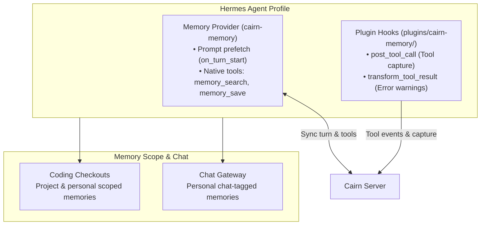

# Hermes Agent

Configure Hermes Agent to use Cairn as its native memory provider and plugin hook engine.



*Hermes integration architecture: Cairn operates as both an external memory provider (for prompt prefetch and native tools) and a standalone plugin (for tool event capture and command warnings).*

## Check the Hermes version

Cairn requires **Hermes v2026.4.23 or newer**:
- v2026.4.16 lacks `transform_tool_result`, preventing failed-command recall.
- Releases prior to v2026.4.16 cannot load external memory providers.
- `cairn setup` and `cairn doctor` verify `__release_date__` in `hermes_cli/__init__.py`.

## Connect a profile

Target the default profile (or specify `HERMES_HOME=/path/to/profile`):

```sh
cairn setup https://cairn.example.com --agent hermes
cairn doctor
```

Verify provider and plugin discovery after restarting Hermes:

```sh
hermes memory status
hermes plugins list
```

- **Memory provider**: Updates `config.yaml` to set `memory.provider: cairn-memory`.
- **Plugin enabled**: Enables `plugins/cairn-memory/` in `plugins.enabled`.
- **Instruction**: Adds a managed instruction block to `SOUL.md`.
- **Native tools**: The provider supplies memory and skill tools directly without separate MCP configuration ([Hermes provider tools](../reference/mcp.md#hermes-provider-tools)).
- **Removal**: Run `cairn setup hermes --remove` to restore the previous memory provider.

## Tool availability

Ensure Hermes's built-in `memory` toolset remains enabled to expose Cairn tools to the model. For multi-user messaging platforms, configure a [dedicated gateway profile](hermes-gateway.md).
