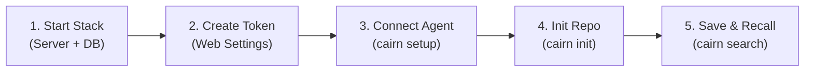

# Quickstart

Get Cairn running, connect your coding agent, and verify memory recall in under five minutes.



*Quickstart workflow: Start the server and database, generate a device token in the web console, connect your agent with CLI setup, initialize your repository, then save and recall a decision.*

<Steps>

<Step>
## Start Cairn and create a device

[Run the local server and console](install-server.md) or connect to an existing server. Open the console at `http://localhost:3000`, sign in, and generate a token under **Settings → Devices**. Copy the token (displayed once).
</Step>

<Step>
## Install and connect an agent

[Install the CLI](install-cli.mdx). Use the agent API address from Settings and connect your agent (example uses Claude Code):

```sh
cairn setup http://localhost:3111 --agent claude
cairn doctor
```

Paste the device token when prompted on stdin. See [Choose an agent](agents/index.md) for agent-specific setup and restart instructions. Resolve any failing [doctor checks](help/doctor.md) before continuing.
</Step>

<Step>
## Initialize a project

Initialize Cairn in your project repository:

```sh
cairn init "Example project"
```

Commit the generated `.cairn/project.json` to share project memories with teammates on the same server. [Read how membership works](memory/scopes.md#init-and-membership).
</Step>

<Step>
## Save and find a decision

Save a verified decision and search for it:

```sh
cairn save '{"kind":"decision","title":"Run database tests in a disposable schema","summary":"Give each test suite its own disposable PostgreSQL schema.","reason":"Test cleanup must leave the shared development database intact.","fields":{"context":"Integration test isolation"}}'
cairn search "disposable PostgreSQL schema"
```

The search returns the decision with its assigned memory ID. Inspect the full record with `cairn get <id>` or open **Memories** in the web console. Next: explore [daily use](daily-use.md).
</Step>

</Steps>
