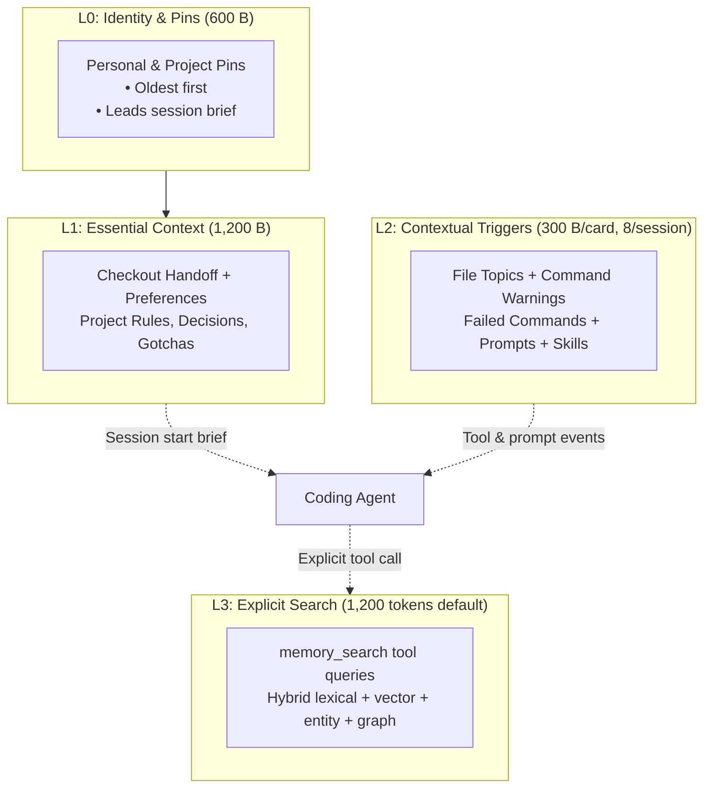

# Recall layers

How Cairn injects identity, essential guidelines, contextual warnings, and search results into agent context.

*Recall layers: L0 and L1 form the opening session brief; L2 pushes targeted warnings during tool use and prompts; L3 serves explicit agent search queries.*

## Automatic recall

| Layer | Content | Budget | Delivery trigger |
| --- | --- | --- | --- |
| **L0 Identity** | Personal pins and current project pins (oldest first) | 600 UTF-8 bytes (~150 tokens) | Session start brief |
| **L1 Essential** | Checkout handoff, personal preferences, project rules, decisions, and gotchas | 1,200 UTF-8 bytes (~300 tokens) | Session start, after L0 |
| **L2 Contextual** | File topics, command warnings, failed-command recall, and prompt cards | 300 UTF-8 bytes per card (max 8 cards/session) | Tool execution, command errors, or prompt match |
| **L3 Search** | Hybrid retrieval results via `memory_search` | Configured token budget (1,200 default) | Explicit agent tool call |

### Delivery rules and budgeting

- **Session brief cap**: Fits within 1,800 bytes when the client requests `extended_brief: true`. Standard clients receive up to 1,200 bytes total.
- **L1 ranking**: Proven memories precede normal memories, sorted by combined fetches and helpful votes, with recent updates breaking ties.
- **Session ledger**: Up to eight L2 cards are shared across briefs, file topics, command warnings, error recall, and prompts per session. Each card consumes one ledger slot.
- **Skill prompt recall**: Prompts outside Hermes gateway chats can inject one matching skill card (requires ≥ 0.60 lexeme overlap).
- **Muting & unmuting**: Three consecutive pushes across separate sessions with zero uses mute a memory from automatic recall. Muting is immediately lifted by an explicit search hit, `memory_get`, or helpful vote.

[Pin a memory](pins.md) · [Use search](recall.md) · [Technical ranking and gates](../../technical/retrieval.md)
