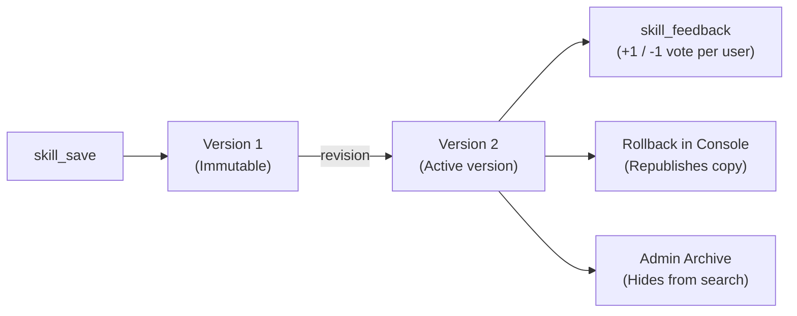

# Skills

Author, version, and share global procedure libraries and workflows across all agents.

*Skill lifecycle: Saving an existing name appends an immutable revision; users vote on specific versions; administrators can roll back or archive skills.*

## Discover and publish skills

- **Search**: `skill_search` searches the global skill library via PostgreSQL full-text search.
- **Read**: `skill_get` fetches a specific version or defaults to the latest active revision.
- **Publish**: `skill_save` registers a skill with a stable lowercase name, title, description, Markdown body, and change note. Re-saving the same name appends an immutable revision.
- **Feedback**: `skill_feedback` records a `helpful` or `wrong` vote against a specific version (one vote per person).

## Limits and governance

| Field | Size limit | Notes |
| --- | --- | --- |
| **Name** | 1–64 characters | Lowercase ASCII letters, numbers, and hyphens |
| **Title** | 80 UTF-8 bytes | Concise label |
| **Description** | 240 UTF-8 bytes | Matched during automatic prompt recall |
| **Change note** | 240 UTF-8 bytes | Describes what changed in this version |
| **Body** | 32,000 UTF-8 bytes | Full Markdown procedure or workflow |
| **Search query** | 1,024 UTF-8 bytes | Maximum query length |

- **Web console**: Browse revision history, inspect author timestamps, or roll back by republishing an earlier revision.
- **Admin archive**: Administrators can archive skills to hide them from agent search without deleting data.

See [MCP contracts](../reference/mcp.md#tools).
