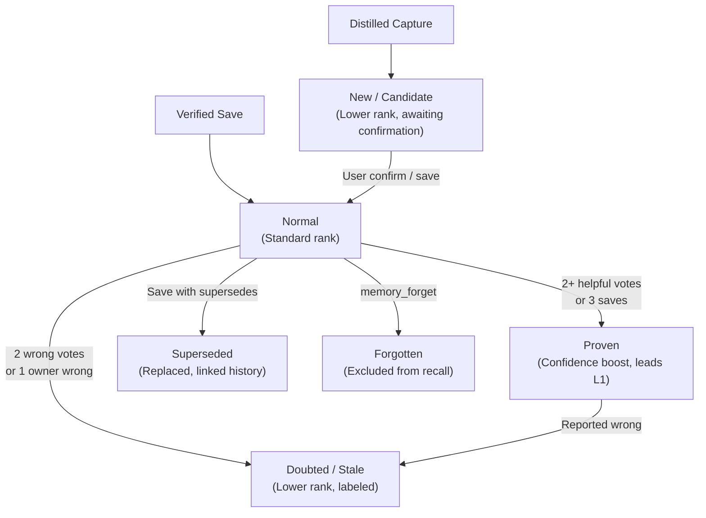

# Trust and corrections

Understand memory confidence ratings, vote on accuracy, record superseding corrections, and forget data.

*Memory lifecycle: Records progress from New to Normal upon verification, reach Proven status with helpful feedback or repeated saves, become Doubted/Stale if reported wrong, link via supersedes on revision, or become Forgotten when removed.*

## Trust labels

Cairn evaluates confidence in order:

1. **Doubted / Stale**: Two distinct users marked the record wrong, or the owner marked it wrong once. Ranks lower with a warning label.
2. **New**: Distilled candidate awaiting verification. Ranks lower and stays out of L1.
3. **Proven**: Validated with at least two helpful votes or three separate saves of the same knowledge. Prioritized in L1 briefs.
4. **Normal**: Standard verified memory.

## Corrections, links and forgetting

- **Supersede**: Pass `supersedes: "<old_id>"` when saving an update. Links historical records and prevents stale advice.
- **Contradict**: Save a `contradicts: "<id>"` link when disputing a record owned by another person or project.
- **Forget**: Call `memory_forget` or `cairn forget <id>` to hide an owned memory from normal recall. Age alone never deletes or hides records.

## Read the counters

Inspect memory confidence metrics in the web console sheet:

- **Shown**: Total times injected into session briefs or contextual tool replies.
- **Used**: Explicit agent fetches, searches, and unprompted gets.
- **Detail**: Requests for full long-form technical content.

See [Recall layers](layers.md) for automatic recall eligibility and muting rules.
