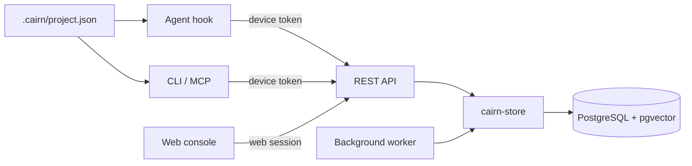
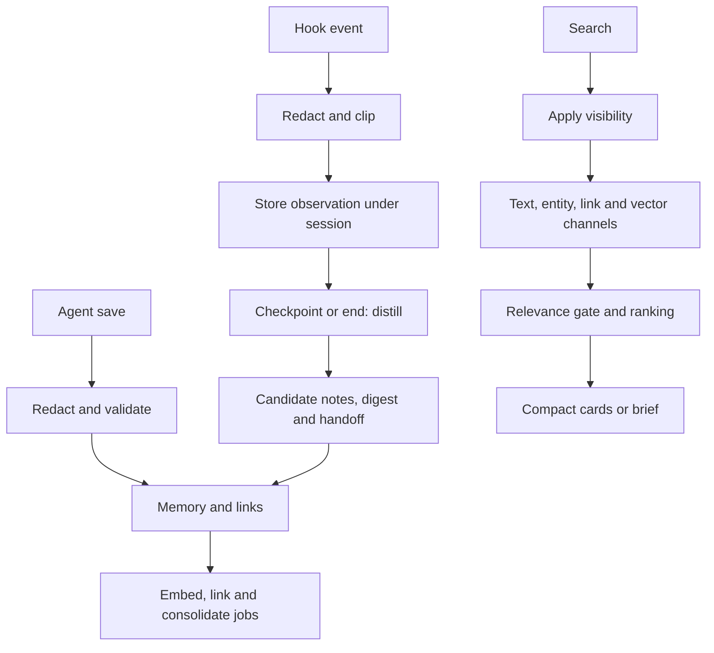

# Architecture — Cairn Memory

Cairn is a self-hosted memory service. A Rust server owns durable state in PostgreSQL with pgvector. Agents use the hook, CLI and MCP through device-authenticated HTTP; people use the web console through web sessions.

## Components

| Component | Responsibility |
| --- | --- |
| `cairn-core` | Types and pure logic for memory, capture, processing, retrieval, projects, accounts and fixes. |
| `cairn-store` | PostgreSQL queries, authorization, transactions, migrations and jobs. |
| `cairn-server` | HTTP routes, authentication and background workers. |
| `cairn-client` | CLI, MCP, hook, setup and updates; communicates over HTTP. |
| `apps/web` | Console for accounts, devices, memories, projects, activity, graph and Fixes. |

Dependencies run from core to store to server; the client uses HTTP rather than opening the store. The worker handles distill, embed, link and consolidate jobs, plus retention and Fixes sweeps. MiniLM runs locally when configured; without it retrieval can use the other channels.

## Data and visibility

Accounts, web sessions, devices and audit events hold identity and authorization data. Projects and members track the shared project ID. Memories, links, entities, usage and aliases describe durable knowledge; sessions and observations hold capture evidence. Jobs track background work; Fixes and lookup logs support diagnosis. Server settings hold global agent instructions, with project overrides on projects.

A memory is personal, project or global. Reads apply ownership and membership checks before returning records. Forgotten memories are excluded from normal recall. Stale and superseded records remain searchable with lower rank and a label; age alone does not hide a memory. Raw observations are retained separately and are not recalled as memory.

## Main flows

Capture stays personal when project attachment fails. A mixed or indeterminate session cohort stays personal. A checkout whose remote matches exactly one existing membership attaches to that project, and those writes are shared with its members; the remote does not grant membership. Recognized projects can receive distilled notes. The hook uses a bounded outbox during outages. Explicit saves are validated and deduplicated; corrections name the old memory in `supersedes`. Forget hides the retained record from normal recall. Feedback can mark a memory stale. A project file identifies membership, so protect it as shared access to the project's memories.

## Decisions and why

- Project owners rename in the web console. Joining uses the project ID even if the file has an old name; `cairn init` updates that name, and session-start notices remind teammates to update and commit the file.
- A matching Git remote attaches only an existing single membership and shares that checkout's writes. It does not grant membership. Mixed capture cohorts stay personal.
- Project archive is a timestamp on the project. The shared store visibility rule hides its project-scoped memories from agent reads, and the console can still read them for members. Writes and background processing check the project state. Restore clears the timestamp and preserves all memory rows and their history. Archive and restore are audited with the state change.

- **Server-authoritative PostgreSQL:** one store and one authorization boundary keep shared state consistent; pgvector supports local semantic retrieval.
- **Self-hosted accounts:** the first account is the administrator; password and device credentials are stored as hashes. Humans manage devices in the web console.
- **Linked corrections:** a replacement links to the previous record, preserving provenance and making both searchable.
- **Scopes and hybrid recall:** personal, project and global scopes set visibility; text, entities, links and local embeddings improve retrieval without broadening access.
- Hooks and agent tools send the same opaque worktree ID derived from the canonical checkout path. This lets explicit search find personal handoffs captured in that checkout.
- **Small agent surface:** five MCP tools, Rust hooks and no server LLM keep operation predictable and avoid an external model dependency.
- Setup and client updates use each host's server-scoped permission format for Cairn MCP in Claude Code, Codex, Grok Build and Antigravity CLI. Grok delivers the brief through PostToolUse, and Antigravity checkpoints through Stop. The device agent CHECK accepts both new host identifiers and preserves existing device rows.
- Long memory detail is limited to 8,000 characters and excluded from identity and embedding text. An additive column and a partial GIN expression index support lowest-weight lexical search on detailed rows while keeping the existing vector and index. Agent reads return the length by default and require a single-memory opt-in for the text.
- Claude memory import uses the existing scoped save and deduplication rules. The client parses Claude's YAML frontmatter with `yaml_serde`, screens for secrets with the shared redactor, and keeps the source and original index on disk. Setup installs shared Cairn-only memory instructions and a configurable Claude write guard to prevent new notes splitting across stores.

See the [release process](release.md) for release and update decisions, and the [user guide](user-guide.md) for operation.
