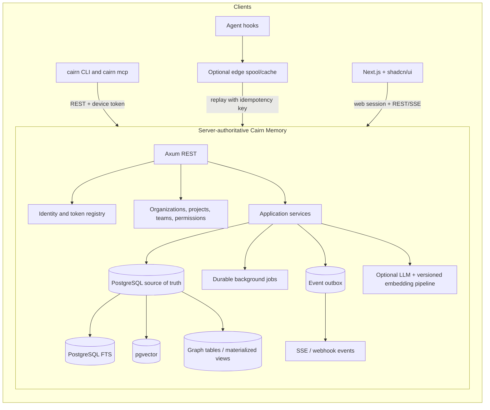

# Architecture — Cairn Memory

Current project collaboration is defined by [ADR 0013](adr/0013-shared-project-decisions-and-personal-memory-scopes.md).
Its all-member decisions, explicit publication, personal scopes and online retrieval
supersede the selective-sharing, team-space and project-delivery proposals below.
The current API contract is [project-layer4](contracts/project-layer4.md).

| Field | Value |
| --- | --- |
| Scope | Server-authoritative Rust backend, optional edge client, Next.js console, persistence, retrieval, and compatibility boundaries |
| Last updated | 2026-11-15 |

## Overview

Cairn Memory is an AI-managed, person-owned memory layer. The Rust server owns canonical people, agents, devices, projects, sessions, observations, memories, permissions, audit history, search data, and background jobs when server mode is enabled. An optional local edge client provides agent-hook capture, privacy filtering, a small cache, and safe replay when the server is temporarily unavailable; it is not a second collaborative source of truth.

PostgreSQL is the canonical server store. PostgreSQL full-text search and pgvector support retrieval alongside ordinary relational queries, while graph tables and materialized views support graph-assisted retrieval. The system uses an append-only, authenticated memory-event log and materialized views for memories, search, graph data, and live counts. Derived indexes can be rebuilt. Source events, identity, visibility, authorization decisions, and audit history must not be silently replaced by a derived summary.

REST is the one application boundary: the web console (web session), hooks, `cairn`, and `cairn mcp` (device token), and optional edge replay all call it. The first useful implementation should be a small vertical slice: capture, automatic memory lifecycle, retrieval, and a viewer. The internal boundaries should remain clear without requiring a distributed deployment. Personal continuity comes before project promotion, cross-person collaboration, or federation. The first deployment is centralized or self-hosted rather than peer-to-peer; federation is a later product decision after identity, revocation, deletion, and recovery are proven.

### Layer 1 prototype boundary

The current Layer 1 implementation is the `cairn-core` crate plus REST and a dependency-free local viewer in `cairn-server`. It uses a versioned, file-backed JSON adapter so capture, redaction, lifecycle classification, session summarization, keyword recall, forget, export/import, and restart persistence can be exercised without requiring PostgreSQL. The Layer 3 `cairn-storage` adapter now provides the first server-authoritative PostgreSQL account, device, observation, and sync-event path.

`apps/web` is the first Next.js App Router console. The browser calls same-origin Next.js routes, those routes proxy to the Rust API at `CAIRN_API_URL`, and the embedded `/viewer` remains.

Humans use only the web console, and only a web session creates, lists, rotates, or revokes device tokens. Agents use a device token through three clients that all call the REST API: the `cairn` CLI and `cairn mcp` (crate `crates/client`, a blocking REST client that never opens a store file or holds an account session) and `scripts/cairn_hook.py` (device token only, posting `sync/push`). `cairn setup <server-url>` reads the token from stdin; `CAIRN_URL` and `CAIRN_DEVICE_TOKEN` together replace the stored config. The CLI, MCP, and the hook accept `https`, or `http` only for a loopback host. A device token gets `403` on account and device management. Credentials are owned by [ADR 0008](adr/0008-self-hosted-account-authentication.md) and [CM-CONTRACT-008](contracts/auth-layer3.md); the tool table is [CM-CONTRACT-002](contracts/mcp-layer1.md); the hook is [CM-CONTRACT-005](contracts/hook-v1.md).

The first Layer 2 slice keeps the same boundary and adds deterministic memory
scopes (`session`, `worktree`, `branch`, `project`, and `global`), structured
coding context (files, symbols, commands, tests, and services), plus optional
current-context filters for search and context assembly. Scope filtering is a
retrieval safety boundary for local continuity, not identity or authorization;
promotion, synchronization, and collaboration remain later services.

The first Layer 3 slice adds a local trusted-device adapter on the same file
store: person-scoped device records, opaque prototype bearer tokens, sync event
cursors, rotation, revocation, and a bounded edge outbox. The PostgreSQL Layer
3 slice adds hashed account/session and device credentials, canonical accepted
observations, sync events, cursors, and the `--database-url` server boundary.

## System Context



## Components

| Component | Responsibility | Owns / Uses |
| --- | --- | --- |
| `domain` crate | Stable entities, value objects, identity, visibility, validation, IDs, and public contracts | Actors, devices, spaces, events, memories, trails, relations, audit records |
| `edge` crate / client package | Optional local capture spool, privacy filtering, retry, and small cache | Local spool files or SQLite, outbox, server cursor |
| `identity` crate | Actor authentication, device registration, token issuance, key rotation, membership, and authorization | People, agents, devices, roles, grants, revocations |
| `spaces` service | Personal, project, team, and organization visibility boundaries | Membership and non-escalation rules |
| `sync` service | Edge replay protocol, idempotency, cursors, fanout, and reconciliation | Server event log, client cursors, conflict records |
| `storage` crate | Transactions, migrations, repositories, and durable job state | PostgreSQL tables, extensions, and migration metadata |
| `services` crate | Product behavior independent of transport | Capture, share, recall, remember, context, export/import, privacy, audit, lifecycle |
| `search` crate | Retrieval streams and authorization-aware ranking | PostgreSQL FTS, pgvector, graph traversal, score fusion, optional reranker |
| `providers` crate | Optional LLM and embedding integrations | HTTP clients, provider configuration, retries, circuit state |
| `jobs` crate | Background work with leases and recovery | Compression, summaries, embeddings, sharing proposals, consolidation, retention |
| `api` crate | REST routes, authentication, request limits, error mapping, and OpenAPI-facing schemas | Axum, Tower middleware, service layer |
| `client` crate (`cairn-client`) | The agent-facing `cairn` CLI and `cairn mcp` stdio server: one shared tool table, one REST call per command or tool, device-token credential | Blocking HTTP client, user config file (mode `0600`), export/import files |
| `apps/web` | Human-facing collaboration and operations console | Next.js App Router, shadcn/ui, typed API client, live event client |

The component boundaries are design seams, not a requirement to deploy separate services. Early layers may run as one Rust process with one database and a small viewer. The system should earn additional queues, projections, providers, and collaboration surfaces through measured need.

## Core Data Model

### Actor

An actor is a person, AI agent, device, or service. Every event and state transition records the actor that created it and, where different, the actor that authorized it.

### Device

A device is a trusted or revoked execution location for an actor. It has its own sync cursor, local outbox, authentication material, last-seen state, and recovery status.

### Space

A space is a visibility and authorization boundary:

- `personal` — one actor's private memory.
- `project` — shared context for a project or repository.
- `team` — shared context for a stable group.
- `organization` — broader administrative or institutional memory.
- `federated` — a future boundary across independently administered services.

Derived memory must not gain visibility beyond the least-visible source it depends on unless an authorized share operation explicitly promotes it.

### Memory event

Memory events are append-only facts or transitions such as:

- observation captured;
- memory proposed, created, updated, or superseded;
- memory shared or access revoked;
- memory forgotten or deleted;
- conflict recorded or resolved;
- device registered or revoked;
- membership granted or removed.

Each event should have an event ID, actor, device, space, timestamp, causal metadata, payload hash, visibility, and authorization context. Materialized memories and indexes are derived from these events.

### Memory autopilot

The memory autopilot is the default product loop, not a manual save workflow:

```text
capture
  -> redact and validate
  -> classify importance, sensitivity, confidence, and freshness
  -> retain, compress, or expire
  -> derive memory with source evidence
  -> retrieve when relevant
  -> suggest correction, promotion, or forget when needed
```

AI or deterministic workers may decide what is relevant and how to summarize it. Authorization, privacy boundaries, and ownership are separate controls and cannot be inferred from relevance alone. A low-confidence or sensitive item remains private or temporary until an explicit policy permits a broader transition.

### Evidence

Evidence is a first-class relationship from a memory to the observation, session, file, symbol, command, test, commit, or other source that supports it. A derived memory must retain enough evidence to answer why it exists, when it was last verified, what scope it applies to, and which later event may invalidate it.

## Main Flow: automatic capture

1. An agent hook sends a bounded JSON payload to the server, or to the optional edge spool when the server is unavailable.
2. The server authenticates the person, agent, device, and token, validates the payload, applies privacy filtering, and checks the idempotency key.
3. A transaction stores the observation and appends a capture event to the event log.
4. The memory autopilot classifies sensitivity, importance, confidence, freshness, source type, branch/worktree context, and possible memory value.
5. The system retains, compresses, expires, or promotes the item according to policy. Durable memories retain source evidence and remain person-owned unless an authorized promotion changes scope.
6. The server schedules optional embedding and enrichment jobs; basic keyword retrieval and context assembly remain available without a remote LLM.
7. A failed client request remains in the edge spool and is replayed after the server returns.

## Main Flow: client replay and delivery

1. A client authenticates to the server and sends a replayed event with its idempotency key.
2. The server validates the actor, token, space, event schema, and authorization context.
3. Accepted events are appended once to PostgreSQL and acknowledged.
4. The client removes the event from its spool only after acknowledgement.
5. Duplicate delivery returns the original acceptance result without creating a second observation.
6. Server-side events are delivered to authorized web sessions, agents, and optional clients through SSE, webhooks, or later pull cursors.
7. Conflicts are represented as explicit records or competing versions rather than silently discarded.

## Main Flow: cross-person collaboration

1. A server worker identifies a possible project fact, decision, handoff, or runbook entry from personal or branch memory.
2. The policy engine checks source visibility, sensitivity, space rules, actor permissions, and evidence quality.
3. The system creates a private project candidate by default. It may create a share candidate or an automatically shared event only when an explicit project policy permits it.
4. An authorized person or policy promotes the candidate; source actors, evidence, scope, and sharing reason remain attached.
5. Authorized collaborators and agents receive the shared memory through normal server retrieval and event delivery.
6. Each recipient receives context according to permissions and token budget, while the viewer exposes the source trail, contributors, sharing reason, freshness, and conflicts.

## Main Flow: recall

1. An agent or user sends a query with person, organization, project, team, branch/worktree, actor, session, layer, and token-budget filters.
2. Authorization filters candidate visibility before content is returned or ranked.
3. PostgreSQL full-text, pgvector, code-graph, memory-graph, and optional reranker streams produce bounded candidates from permitted material.
4. The ranker fuses candidates and applies freshness, confidence, provenance, branch relevance, diversity, and scope rules.
5. The response includes compact results, source IDs, visibility metadata, scope, freshness, and enough information for expansion.
6. The user or agent can inspect why a result was recalled, which evidence contributed to it, and what may make it stale.

## Main Flow: automatic background work

1. A service creates a durable job with a type, payload, space, attempt count, and next-run time.
2. A worker claims the job with a lease so another worker cannot process it concurrently.
3. The worker executes with bounded timeouts and provider-specific retry policy.
4. Success marks the job complete; a retryable failure schedules backoff; a permanent failure enters a dead-letter state.
5. A sharing or classification failure must fail closed: it may delay collaboration but must not broaden visibility.
6. Status and repair commands expose pending, failed, paused, and quarantined work to operators.

## Main Flow: console updates

1. Next.js loads an authorized snapshot through REST.
2. The viewer presents memory, evidence, scope, freshness, exceptions, and sync state without requiring manual filing.
3. The console opens an authenticated SSE connection for changes when live updates are useful.
4. The backend publishes outbox events after committed state changes.
5. The browser invalidates or patches the affected view instead of treating the stream as the source of truth.
6. Reconnects fetch a fresh snapshot and resume from a bounded cursor when supported.

## Interfaces

| From | To | Interface | Purpose |
| --- | --- | --- | --- |
| Agent hooks | Server or optional edge spool | HTTP JSON with a device token | Session lifecycle and observation capture |
| `cairn` CLI and `cairn mcp` | Server | REST JSON over HTTPS (HTTP on loopback), device token | Recall, save, search, project, and share tools for agents; no account or device management |
| Edge spool | Server | Authenticated replay HTTP | Outage-tolerant capture delivery |
| Next.js console | Server | REST JSON | Identity, spaces, memory, collaboration, and operations |
| Next.js console | Event service | SSE initially | Live health, counts, conflicts, jobs, and row changes |
| Services | Providers | Provider trait over HTTP | Optional compression, summaries, graph extraction, and embeddings |
| Services | Storage | Repository and transaction traits | PostgreSQL domain state, event log, vector data, and job coordination |
| `cairn export` / `cairn import` | Server | Versioned JSON export/import over REST | Portable migration without depending on internal storage layout |

## Data

| Data | Owner | Storage | Notes |
| --- | --- | --- | --- |
| Actors and devices | Identity service | PostgreSQL | Authentication, ownership, status, tokens, and device metadata |
| Spaces and memberships | Space service | PostgreSQL | Roles, grants, revocations, and non-escalation rules |
| Observations | Capture service | PostgreSQL | Canonical server records; edge spool is temporary delivery state |
| Memory events | Event service | PostgreSQL append-only tables | Idempotent, authenticated, causally ordered where needed |
| Derived memories | Memory service | PostgreSQL materialized views/tables | Preserve source event IDs and visibility bounds |
| Trails and provenance | Memory/governance service | Event log plus query indexes | Explain source, actor, transformation, sharing, and conflict history |
| Embeddings | Search service | pgvector | When enabled, model/version/dimension metadata is mandatory; re-embedding is a job |
| Text and graph indexes | Search service | PostgreSQL FTS, graph tables, and materialized views | Rebuildable; never the only copy of canonical memory content |
| Jobs and leases | Job service | PostgreSQL | Retry state, lease expiry, errors, quarantine, and dead letters |
| Audit entries | Governance service | PostgreSQL append-only records | Sharing, access, membership, deletion, and revocation operations |
| Edge spool and replay cursor | Edge client | Local filesystem or SQLite | Temporary outage tolerance; server remains canonical |

## Constraints

- **Private by default** — automatic capture must not imply automatic sharing.
- **AI-managed, human-owned** — automated workers manage relevance, compression, retention, and retrieval; the person owns the memory and controls correction, deletion, export, and sharing.
- **Relevance is not authorization** — a highly relevant memory cannot bypass scope, privacy, membership, or revocation rules.
- **Identity first** — every write, transformation, share, read, revoke, and forget operation has an actor and authorization context.
- **Server authoritative** — PostgreSQL is the canonical source of truth for all accepted shared and durable memory.
- **Outage tolerant** — a client can buffer capture locally and replay it after reconnect; full offline collaborative recall is not required initially.
- **Idempotent delivery** — duplicate replay, retries, and reconnects cannot duplicate memory events.
- **Safe derived state** — indexes and projections may be deleted and rebuilt without losing canonical events.
- **Fail closed** — uncertainty in authorization or sensitivity classification must not broaden visibility.
- **LLM optionality** — capture, indexing, keyword recall, deterministic classification, and graph extraction from code structure work without a remote LLM key.
- **Versioned semantic retrieval** — semantic retrieval may use a local or remote embedding model, but model ID, version, dimensions, and re-embedding state are explicit. It must not be a prerequisite for the first usable personal-memory layer.
- **Privacy** — secrets and private payloads are scrubbed before persistence, logging, sharing, or provider calls.
- **Bounded latency** — hooks, sync, and recall paths need explicit request, payload, and retrieval budgets.
- **Cross-platform packaging** — the server, optional edge spool, and CLI behavior must work on macOS, Linux, and Windows.
- **Observable recovery** — sync lag, stale indexes, conflicts, revoked devices, failed jobs, and migration problems need visible status and repair actions.

## Key Decisions

- [ADR 0001 — Compatibility-first rewrite](adr/0001-compatibility-first-rewrite.md) — preserve the AgentMemory-facing contracts while replacing the internal runtime incrementally.
- [ADR 0002 — Collaborative sync model](adr/0002-collaborative-sync-model.md) — use scoped spaces, explicit identity, append-only events, and centralized/self-hosted sync before federation.
- [ADR 0003 — Server-authoritative PostgreSQL](adr/0003-server-authoritative-postgres.md) — keep canonical data and retrieval state on the server, with clients limited to outage buffering and cache behavior.
- [ADR 0004 — Trunk-based development and release](adr/0004-trunk-based-development-and-release.md) — use short-lived branches/worktrees, protected trunk, CI, and GitHub release tags.
- [Product — Cairn Memory](product.md) — owns product purpose, collaboration model, principles, and boundaries.
- [Roadmap — Cairn Memory](roadmap.md) — owns phase order and milestone gates.
- [Collaborative memory specification](specs/collaborative-memory.md) — owns the first feature-level behavior and acceptance criteria.
- [Memory context and promotion](specs/memory-context-and-promotion.md) — owns scopes, branch/worktree context, promotion, and context packing.
- [Graph-assisted retrieval](specs/graph-assisted-retrieval.md) — owns embeddings, code graphs, memory graphs, and hybrid retrieval.
