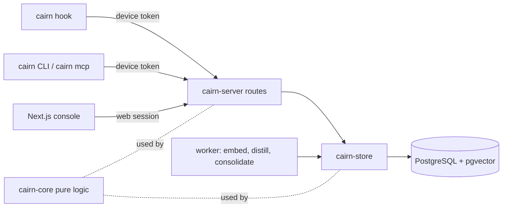

# Architecture — Cairn Memory

| Field | Value |
| --- | --- |
| Scope | The 0.1.6 server, its crates, data ownership, interfaces and main flows |
| Last updated | 2026-11-21 |
| Design source | [0.1.6 foundation specification](specs/0.1.6-foundation.md) |

Cairn Memory is an AI-managed, person-owned memory layer. One Rust server owns everything durable, in
one PostgreSQL schema (`cairn`, migration `migrations/0001_foundation.sql`). Agents reach it through
three clients that all call the same REST API with a device token; people use the web console with a web
session. There is no file store, no embedded viewer, no sync pull and no import: the earlier designs
are in [`archive/`](README.md#archive) and the ADRs.

## Crates

| Crate | Responsibility |
| --- | --- |
| `cairn-core` | Pure types and logic, no IO and no `sqlx`, `tokio`, `axum` or `reqwest`. Areas `memory`, `capture`, `process`, `retrieve`, `project`, `account`, each with a README |
| `cairn-store` | Every SQL query behind `Store`; the visibility rule, transactions, migrations, jobs; `TestDb` for tests |
| `cairn-server` | Axum routes under `/cairn-memory`, authentication, `{error, code}` errors, and the background worker with the local MiniLM model |
| `cairn-client` | The `cairn` CLI and `cairn mcp` stdio server (one tool table), project file, `cairn hook`, agent setup, `cairn update` |
| `apps/web` | Next.js console: dashboard, memories, graph, projects, jobs, devices, accounts |

Dependencies point one way: `core` ← `store` ← `server`; `client` talks to the server over HTTP only.
Inside `core`, `memory` is the base, and `capture`, `process`, `retrieve`, `project` and `account` use
only `memory` and each other.

## Data

| Table | Owner | Notes |
| --- | --- | --- |
| `accounts`, `web_sessions`, `devices`, `audit_events` | `account`, `device` | Tokens are stored as hashes; audit rows are metadata only |
| `projects`, `project_members` | `project` | A repository joins a project through the committed `.cairn/project.json` id; the owner is also a member row |
| `memories`, `links`, `entities`, `usage` | `memory` | `kind` (decision, rule, gotcha, procedure, fact, preference, note, handoff), `scope` (personal, project, global), `status` (active, stale, superseded, forgotten). `links` carry supersedes, contradicts, relates, causes, fixes, depends_on |
| `memory_embeddings` | `embed` | 384-dimension MiniLM vectors with an HNSW index; keyed by a source hash |
| `sessions`, `observations` | `capture` | Raw evidence; never recalled directly; expired and swept |
| `jobs` | `process::jobs` | `embed`, `distill`, `consolidate`; one status column; leases and backoff |

Visibility is one SQL rule used by every read: not forgotten, not expired, and the caller is the owner, or
the memory is global, or it is project-scoped and the caller is a member of that project.

## Main flows

1. **Capture.** A hook posts an observation (device token). The server redacts it, stores it under the
   session, and answers with `project_attachment` (`attached` or `personal`). Session end or checkpoint
   enqueues a `distill` job that writes one `handoff` note per session.
2. **Save.** An agent sends a `SaveInput` to `/remember`. `process::prepare_save` redacts, validates the
   fields for the kind, applies the kind policy (scope, expiry), derives entities and hashes, and the
   store writes it. An identical save is deduplicated; a save that names `supersedes` or `contradicts`
   writes link rows. A forgotten identity returns 409.
3. **Process.** The worker embeds new memories, then runs `consolidate`: a neighbour with the same owner,
   scope, project and kind and cosine ≥ 0.92 is superseded by the newer memory; 0.75–0.92 adds a
   `relates` link. Nothing is queued for a human.
4. **Recall.** `/search` runs lexical, entity and vector
   channels over visible rows, fuses them (RRF), applies the relevance floor and usage multipliers, then
   packs compact results with `more: n` for what was cut. `kind=handoff` finds handoffs, `kind=decision` replaces
   why-changed, and the session brief reads handoffs and links.
5. **Feedback and forget.** `helpful` and `wrong` votes (one per person) change `usage` and may mark a memory stale; a stale memory still ranks, lower, and its card says so.
   Forget blanks the text and deletes its embedding, entities and links; the identity hash stays.

## Constraints

- **Private by default.** Capture is personal. A memory is shared only by its scope (`project` memories reach
  members; `global` reaches every account).
- **Server authoritative.** PostgreSQL is the only store. A client keeps at most a bounded outbox.
- **No LLM.** Capture, entities, distill, consolidate and search work without a model API. Only the local
  MiniLM embedding model runs, inside the server, with no network.
- **Fail closed.** A request that cannot be authorized or classified is refused, not widened.
- **Automation first.** There are no review queues; consolidation and expiry run in the worker.

## Key decisions

- [0.1.6 foundation specification](specs/0.1.6-foundation.md) — the schema, model and module map above.
- [ADR 0003 — Server-authoritative PostgreSQL](adr/0003-server-authoritative-postgres.md), [ADR 0008 — Self-hosted account authentication](adr/0008-self-hosted-account-authentication.md), [ADR 0013 — Shared project decisions and personal memory scopes](adr/0013-shared-project-decisions-and-personal-memory-scopes.md) (superseded in detail by the 0.1.6 model: no publication copies), [ADR 0014 — Memory scopes, distillation and hybrid recall](adr/0014-memory-scopes-distillation-and-hybrid-recall.md).
- Contracts: [MCP tools](contracts/mcp-layer1.md), [hook](contracts/hook-v1.md), [authentication](contracts/auth-layer3.md), [projects](contracts/project-layer4.md), [recall](contracts/continuity-v1.md).
