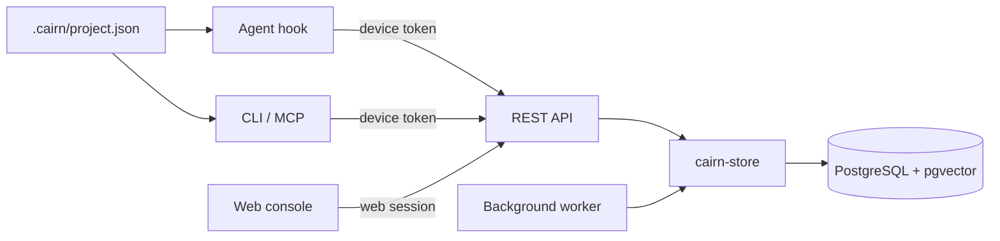
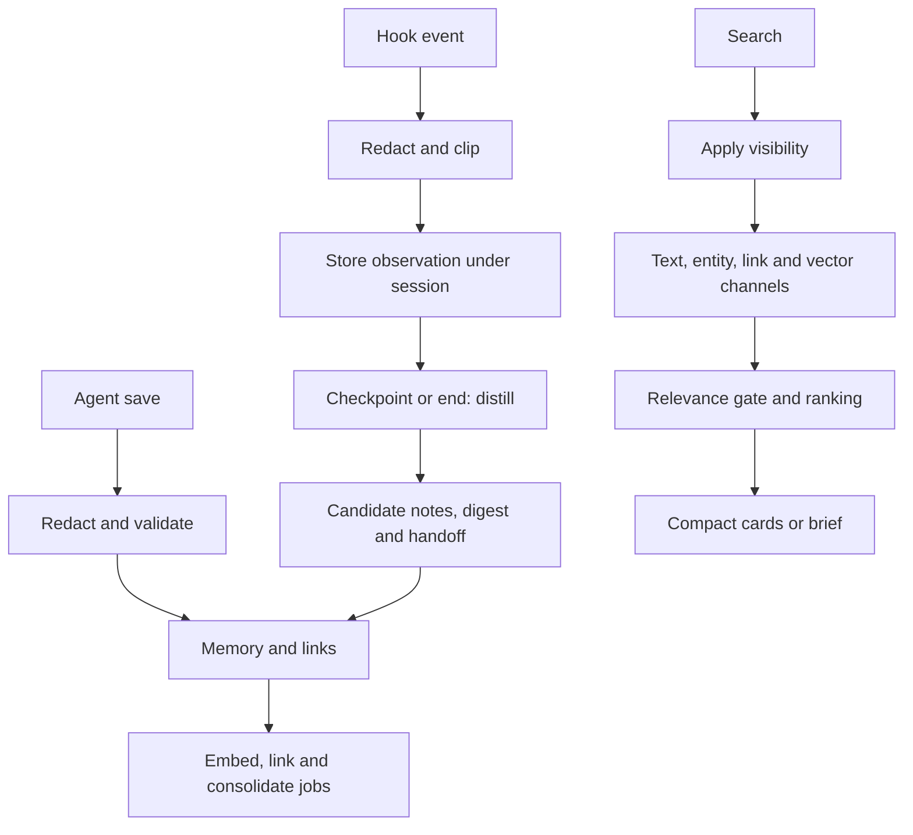

# Architecture — Cairn Memory

Cairn is a self-hosted memory service. A Rust server owns durable state in PostgreSQL with pgvector. Agents use the hook, CLI and MCP through device-authenticated HTTP; people use the web console through web sessions.

## Components

| Component | Responsibility |
| --- | --- |
| `cairn-core` | Types and pure logic for memory, capture, processing, retrieval, projects, accounts and fixes. |
| `cairn-store` | PostgreSQL queries, authorization, transactions, migrations and jobs. |
| `cairn-server` | HTTP routes, authentication and background workers. |
| `cairn-client` | CLI, MCP, hook, setup and updates; communicates over HTTP. |
| `apps/web` | Console for accounts, devices, memories, skills, projects, activity, graph and Fixes. |

Dependencies run from core to store to server; the client uses HTTP rather than opening the store. The worker handles distill, embed, link and consolidate jobs, plus retention and Fixes sweeps. MiniLM runs locally when configured; without it retrieval can use the other channels.

## Data and visibility

Accounts, web sessions, devices and audit events hold identity and authorization data. Projects and members track the shared project ID. Memories, links, entities, usage and aliases describe durable knowledge; sessions and observations hold capture evidence. Jobs track background work; Fixes and lookup logs support diagnosis. Server settings hold global agent instructions, with project overrides on projects.

A memory is personal, project or global. Reads apply ownership and membership checks before returning records. Forgotten memories are excluded from normal recall. Stale and superseded records remain searchable with lower rank and a label; age alone does not hide a memory. Raw observations are retained separately and are not recalled as memory.

## Main flows

Capture stays personal when project attachment fails. A mixed or indeterminate session cohort stays personal. A checkout whose remote matches exactly one existing membership attaches to that project, and those writes are shared with its members; the remote does not grant membership. Recognized projects can receive distilled notes. The hook uses a bounded outbox during outages. Explicit saves are validated and deduplicated; corrections name the old memory in `supersedes`. Forget hides the retained record from normal recall. Feedback can mark a memory stale. A project file identifies membership, so protect it as shared access to the project's memories.

## Decisions and why

- Project owners rename in the web console. Joining uses the project ID even if the file has an old name; `cairn init` updates that name, and session-start notices remind teammates to update and commit the file.
- A matching Git remote attaches only an existing single membership and shares that checkout's writes. It does not grant membership. Mixed capture cohorts stay personal.
- Project archive is a timestamp on the project. The shared store visibility rule hides its project-scoped memories from agent reads, and the console can still read them for members. Writes and background processing check the project state. Restore clears the timestamp and preserves all memory rows and their history. Archive and restore are audited with the state change.

- **Server-authoritative PostgreSQL:** one store and one authorization boundary keep shared state consistent; pgvector supports local semantic retrieval.
- **Self-hosted accounts:** the first account is the administrator; password and device credentials are stored as hashes. Humans manage devices in the web console.
- **Linked corrections:** a replacement links to the previous record, preserving provenance and making both searchable.
- **Scopes and hybrid recall:** personal, project and global scopes set visibility; text, entities, links and local embeddings improve retrieval without broadening access.
- Hooks and agent tools send the same opaque worktree ID derived from the canonical checkout path. This lets explicit search find personal handoffs captured in that checkout.
- **Small agent surface:** five memory tools and four skill tools over MCP, Rust hooks and no server LLM keep operation predictable and avoid an external model dependency.
- Setup and client updates use each host's server-scoped permission format for Cairn MCP in Claude Code, Codex, Grok Build and Antigravity CLI. Grok delivers the brief through PostToolUse, and Antigravity checkpoints through Stop. The device agent CHECK accepts both new host identifiers and preserves existing device rows.
- Hermes setup uses full trust scoped to the Cairn MCP server. Its plugin bridges native lifecycle callbacks to the Rust hook and injects the session brief before the first inference. Migration 0020 widens the device agent CHECK to include Hermes and preserves existing rows.
- Dedicated Hermes gateways replace the managed MCP entry with native chat search and save. Cairn hashes the bound chat and thread route with a profile salt. Every chat has the same personal-memory boundary. A tool request may select a project by ID or exact name, with current membership required for search and save. Explicit project saves have no chat tag. Group saves start as candidates. Migration 0023 adds the nullable personal chat tag, and migration 0024 removes obsolete sender metadata from retained contexts. Dedupe, consolidation, handoff chains, and JSON export and import preserve the tag. The global chat instruction lives in `server_state` and rides with the first prompt after each chat session starts. Hermes handles owner confirmation and conversation. The plugin skips background turns and reuses Cairn's recall ledger and distillation for interactive turns.
- Long memory detail is limited to 8,000 characters and excluded from identity and embedding text. An additive column and a partial GIN expression index support lowest-weight lexical search on detailed rows while keeping the existing vector and index. Agent reads return the length by default and require a single-memory opt-in for the text.
- The save tool recommends titles of up to 10 words and one-sentence summaries of up to 30 words so agents can draft to the character limits. The server reports the actual length and how many characters to cut. Batch errors identify the failing note by its zero-based index.
- Explicit agent saves use deterministic quality coaching after validation. Thin or near-duplicate notes start at rank `candidate` with actionable hints. Duplicate coaching uses title and summary lexemes within the caller's own active scope and project cohort because the save can finish before embeddings are available. Reads and repeated weak saves preserve the candidate rank, and automatic consolidation skips these notes. A helpful vote confirms a candidate, and a clean explicit correction saves at normal rank. System distillation and web JSON import retain their existing rules.
- Trust is derived at read time from status, rank, votes and repeat saves. Agent results and console views use the same rule, and search scoring retains its existing weights. Per-memory usage distinguishes explicit reads from memories shown in hook replies. A full-detail get counts both as a read and as a detail open. Automatic recall records the memories that fit in the rendered context. A transaction serializes automatic pushes per person and updates the session ledger and usage counts together. The ledger lives for seven days and shares eight slots across brief, topic, command and prompt recall requests. The optional session ID lets a stdio MCP client join its hook session's budget while older clients can still request recall.
- Command warnings and failed-command recall use lexical matches and exact normalized command entities under a short deadline. The shown ledger stores a hash of the command for delivered warnings to enforce one warning per session. Failed-command requests carry only a redacted 2 KiB output tail. The tail has no persistence path through recall.
- Prompt recall shares hybrid search and narrows scope, kinds, trust and prior pushes inside each candidate channel. A stricter relevance gate, a 300-byte reply, and independent deadlines keep prompt hooks quiet on weak matches and slow requests. An explicit named preference cue uses the same evidence floor as an exact entity.
- Migration 0025 adds a global skill library with immutable text versions and one vote per person and version. Any account can publish a new version or roll back by copying an older one. Administrator archive and restore operations record the actor in the audit log and preserve every version. PostgreSQL full-text search reads the active version. Prompt recall can reserve one active skill card in the existing eight-card session budget. Hermes gateway chats expose the four skill tools with no chat metadata and skip automatic skill cards. The web offers conversion of visible active procedures with steps after five fetches or two helpful votes. A person explicitly publishes the conversion or dismisses the suggestion.
- Automatic recall learns per person. Migration 0021 does not backfill the old ledger, so every card starts with a fresh window. Durable counts mute a card after three unused sessions without changing trust or search visibility. An explicit search hit, get or helpful vote restores eligibility. Session rows distinguish inferred error use from verified gets or votes so a later matching failure can undo only the inferred credit.
- The session brief reserves 600 bytes for explicit pins and 1,200 bytes for essentials ranked by trust, use and age. Clients opt in to the 1,800-byte ceiling with `extended_brief`. Until they update, the server preserves L0 and uses the remaining space under the 1,200-byte ceiling for L1. Both layers reserve their rendered IDs in the existing session ledger. Migration 0022 adds a nullable pin timestamp. The web route checks memory ownership and project membership, and transaction locks enforce personal and project quotas across concurrent writes. Pins bypass per-person recall mutes.
- Claude memory import uses the existing scoped save and deduplication rules. The client parses Claude's YAML frontmatter with `yaml_serde`, screens for secrets with the shared redactor, and keeps the source and original index on disk. Setup installs shared Cairn-only memory instructions and a configurable Claude write guard to prevent new notes splitting across stores.
- Doctor warns when an installed integration's global instruction block drifts from setup's version or when an existing Claude memory folder lacks the imported pointer. It honors Claude's native-memory opt-out and Hermes gateway profiles, which receive chat-scoped instructions. The checks leave repair to setup and import.

See the [release process](release.md) for release and update decisions, and the [user guide](user-guide.md) for operation.
