# Cairn Memory Data Flow Guide

A picture-first explainer of how Cairn memory works today, for someone who does not read the code. It describes what the code does as of 2026-11-15; the diagrams were read from the code, not produced by running it. Behavior rules live in their owners: [architecture](./architecture.md), [policy](./policy.md), and the [contracts](./contracts/). If this guide and an owner disagree, the owner wins and this guide needs a fix.

**How to read the diagrams.** A solid arrow always happens. A dashed arrow is optional or conditional. Anything not built is marked "not implemented" in the text, not drawn.

**Two stores.** The server keeps data in either a JSON file (`--store`) or PostgreSQL (`--database-url`). The Docker dev stack uses PostgreSQL. Both expose the same routes. Differences that matter are listed at the end of the capture section.

**Two credentials.** A *web session* is what a person gets by signing in to the console. A *device token* is what an AI agent uses; only a web session can create one. Section 7 explains the split, including the one admin account that creates all other accounts.

| Word | Meaning |
| --- | --- |
| Observation | One captured event, such as a tool result. Raw and temporary. |
| Session | A run of work; observations belong to one. |
| Memory | Something Cairn keeps: a session summary, a saved fact or lesson, a correction, or a project decision. |
| Project | A repository registered under a person, with branches and optional members. |
| Decision | A memory copied into a project (the result of promotion). |

## 1. System map

Two kinds of users reach one server. People use the web console, which holds their sign-in as an httpOnly cookie and forwards it as a bearer token. Agents use a device token through the hook, the `cairn` command, or `cairn mcp`. The hook reads its URL and token only from environment variables; the CLI and MCP read a saved config file or the same two variables. The URL may include a path prefix when a reverse proxy mounts the API under one (for example `https://cairn.example.test/agent`); see [deploy](./deploy.md).

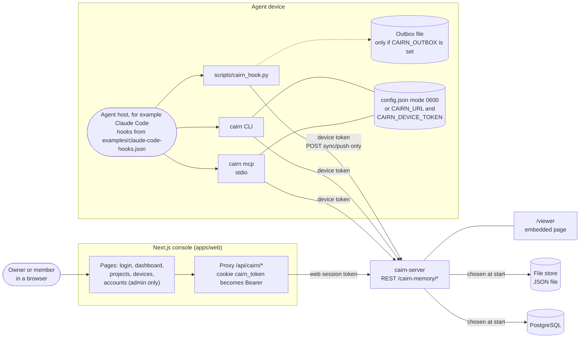

Where in the code: `apps/web/app/api/cairn/[...path]/route.ts` (proxy, cookie), `crates/server/src/main.rs` (store choice, idle sweep timer), `crates/client/src/` (CLI, MCP, config), `scripts/cairn_hook.py`, `scripts/cairn_outbox.py`, `examples/claude-code-hooks.json`.

## 2. Memory lifecycle

Everything starts as a raw observation. Secrets are scrubbed first and the sensitivity label can only be raised, never lowered. When a session has had no new capture for 30 minutes, it is turned into one durable summary memory. That happens on the same person's next push or session start, or at the latest on the server's 5-minute timer, so a session closes even when the agent just stops. People can correct (replace but keep history) or forget (hide but keep the record).

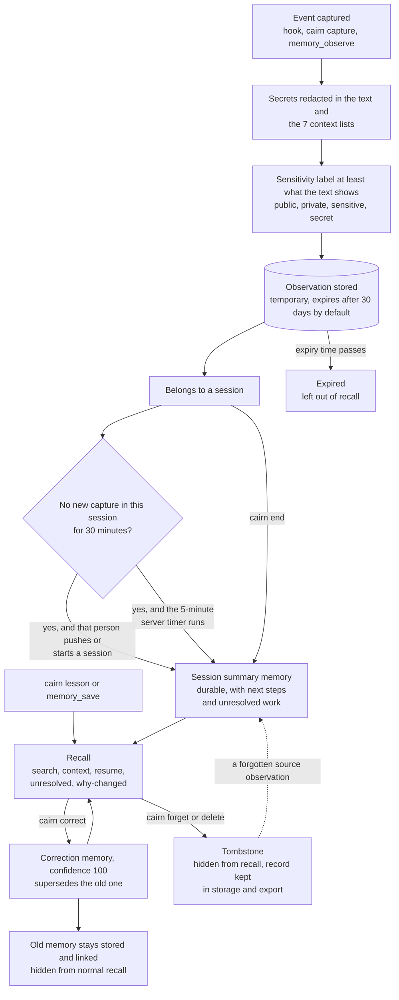

The last dashed arrow means: if a source observation of a summary is forgotten, the next sweep or explicit end rebuilds the summary from what remains. A summary the person forgot or corrected is never rebuilt. A forget also leaves a deletion instruction in the person's sync stream; section 8 explains why no shipped client needs to read it.

Where in the code: `crates/core/src/lib.rs` (`finish_idle_sessions`, `sweep_idle_sessions`, `Lifecycle::observation`, `correct_for_account`, `hide_id`, `summary_is_stale`, `build_session_digest`), `crates/storage/src/lib.rs` (`IDLE_SESSION_SECONDS`, `finish_idle_sessions`, `sweep_idle_sessions`), `crates/server/src/main.rs` (`IDLE_SWEEP_INTERVAL`), `migrations/0012_session_summary_pending.sql`. Rules: [lifecycle](./contracts/lifecycle-v1.md), [continuity](./contracts/continuity-v1.md).

### 2.1 What each Claude Code hook sends

`examples/claude-code-hooks.json` runs `scripts/cairn_hook.py` for four Claude Code hook events. Claude Code passes one JSON object on standard input; the hook turns it into one `sync/push` body. Every body has the same shape: `eventId`, `sessionId`, `content`, `role`, `source`, plus a `context` (section 2.1) and an empty `lifecycle`.

| Event | When Claude Code fires it | Fields the hook reads | `content` | `role` | `source` |
| --- | --- | --- | --- | --- | --- |
| `UserPromptSubmit` | The user submits a prompt, before Claude works on it | `session_id`, `hook_event_name`, `prompt` | The prompt text | `user` | `UserPromptSubmit` |
| `PostToolUse`, matcher `Bash\|Edit\|Write\|MultiEdit` | One of those four tools has finished | `session_id`, `hook_event_name`, `tool_name`, `tool_input`, `tool_response`, `tool_use_id` | `<tool_name> {"tool_input":...,"tool_response":...}` as compact sorted JSON, cut to 16000 characters | `tool` | `PostToolUse` |
| `Stop` | Claude finishes answering a turn | `session_id`, `hook_event_name`, `last_assistant_message` | The final reply of the turn | `assistant` | `Stop` |
| `SessionEnd` | The Claude Code session ends | `session_id`, `hook_event_name`, and every other field | The whole input object as compact sorted JSON | `tool` | `SessionEnd` |

Claude Code also sends fields the hook does not copy into the content, such as `cwd`, `transcript_path`, and `permission_mode`; they matter for the content only on `SessionEnd`, where the whole object (including `cwd` and `transcript_path`) becomes the content. The hook does read `cwd`, for `context` (below). When a field the hook looks for is missing (for example `Stop` without `last_assistant_message`), the whole input object becomes the content instead. When Claude Code fires each event follows its hooks reference and was not checked in this repository.

How the hook builds the rest of the body:

- `sessionId` is Claude Code's `session_id`. Without one the hook needs `CAIRN_SESSION_ID`, or it exits.
- `eventId` is `hook-` plus the first 24 hex characters of a SHA-256 over the JSON of `sessionId`, `source`, `content`, and, for `PostToolUse`, `tool_use_id`. It is computed before redaction. Claude Code sends no event id of its own. Consequence: an identical prompt or reply repeated in one session is the same event and is stored once; two identical tool results stay separate because their `tool_use_id` differs.
- `content` over 64 KiB is cut at a character boundary and ends with `[truncated]`, so the capture is kept instead of rejected.
- Before sending, the hook redacts secrets in `content` (and in the 7 context lists, which the hook leaves empty). The server redacts again and sets the sensitivity floor.
- `context` holds a repository and branch derived from `cwd`, because Claude Code's input carries no repository or branch field. The hook runs `git -C <cwd>` (at most three calls, no shell, 1 second each): `repository` is the last path part of `remote.origin.url` without `.git` (for example `widget` from `https://host/acme/widget.git`), or the top-level directory name when there is no origin; `branch` is the current branch, and a detached HEAD sends none. A `cwd` that is not a git repository, or a machine without `git`, leaves `context` empty. An explicit `context.repository` in the input is never replaced. The event id does not depend on the context. Section 2.5 lists what this does not fix.

What the hook produces for one run of each event (`session_id` `cc-7f3a`; these values come from running the hook's request builder, without a server):

| Event | Claude Code input (shortened) | `eventId` | `content` stored |
| --- | --- | --- | --- |
| `UserPromptSubmit` | `{"prompt":"fix the login bug in auth.rs", ...}` | `hook-3e2f0bb34c5230a4cfaa4a82` | `fix the login bug in auth.rs` |
| `PostToolUse` | `{"tool_name":"Bash","tool_use_id":"toolu_01A","tool_input":{"command":"cargo test"},"tool_response":{"stdout":"test result: ok","stderr":""}}` | `hook-770b1771fc1e5de19a7725fa` | `Bash {"tool_input":{"command":"cargo test"},"tool_response":{"stderr":"","stdout":"test result: ok"}}` |
| `Stop` | `{"last_assistant_message":"Fixed. The test passes.", ...}` | `hook-6cb560963b2d2af1bdc9a165` | `Fixed. The test passes.` |
| `SessionEnd` | `{"reason":"other","cwd":"/work/app","transcript_path":"/t.jsonl", ...}` | `hook-19f20cf5c1b062056dd8c714` | `{"cwd":"/work/app","hook_event_name":"SessionEnd","reason":"other","session_id":"cc-7f3a","transcript_path":"/t.jsonl"}` |

The server turns each of these into an observation: the same text after redaction, a sensitivity label, a temporary retention (30 days by default), the person who owns the device, and a sync cursor. After a 30-minute pause, those four become one session summary memory along these lines (shortened):

```text
Session summary (deterministically compressed):
- fix the login bug in auth.rs [evidence: hook-3e2f0bb34c5230a4cfaa4a82]
- Bash {"tool_input":{"command":"cargo test"}, ...} [evidence: hook-770b1771fc1e5de19a7725fa]
- Fixed. The test passes. [evidence: hook-6cb560963b2d2af1bdc9a165]
- {"cwd":"/work/app","hook_event_name":"SessionEnd", ...} [evidence: hook-19f20cf5c1b062056dd8c714]
Source actors:
- UserPromptSubmit
- PostToolUse
- Stop
- SessionEnd
```

The summary lists repeated lines once, notes how many it left out, and pulls lines containing words such as "next step", "todo", or "blocked" into its next-steps and unresolved-work lists.

Where in the code: `scripts/cairn_hook.py` (`build_request`, `git_context`, `HOST_ROLES`, `TOOL_CONTENT_CHARS`), `scripts/cairn_outbox.py` (`normalize`), `crates/core/src/lib.rs` (`build_session_digest`, `derive_session_memory`). Rules: [hook](./contracts/hook-v1.md#claude-code-hook-input).

### 2.2 One prompt, from keystroke to later recall

This is the whole path for one event, including the failure branch and the two ways a session closes. Steps 1 to 15 happen within a second or two (the replay in steps 11 to 14 is capped at about 2 seconds); steps 16 to 21 happen later.

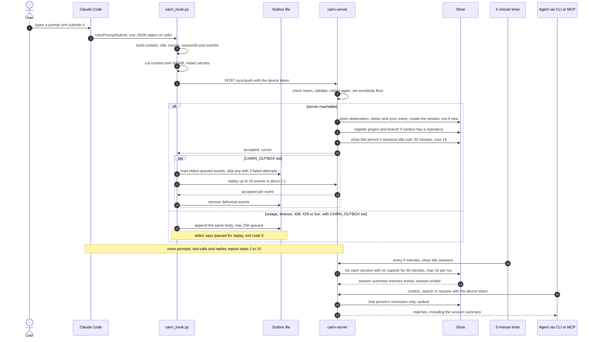

Notes on the steps:

- Step 5 sends at most one request per event and never follows a redirect. A `401`, a `409`, or any other `4xx` is not queued: the hook exits with an error and the event is lost (a `409` means the same event id already holds different content).
- Without `CAIRN_OUTBOX`, any failed delivery exits with an error and the event is lost.
- A full queue, a disk error, or a busy queue lock when the hook needs to append also exits with an error and the capture is not kept.
- The replay in steps 11 to 14 runs only after the hook's own event was accepted, it never purges, and a failure in it never changes the hook's exit code. The queued events themselves go through the same server checks and writes as steps 6 to 9.
- The session row is created by the push itself on both stores (the hook never starts a session). On PostgreSQL the push also marks the session pending with the time of the capture; the 30-minute clock counts from the newest capture.
- The `SessionEnd` event does not end the Cairn session. It is one more observation and restarts the 30-minute clock. The session closes through the idle rule, or earlier with `cairn end` or `memory_session_end`.

### 2.3 A session's life

A session is the unit that gets summarised. Its id is Claude Code's `session_id`. "Idle" is not stored; it is simply 30 minutes without a capture.

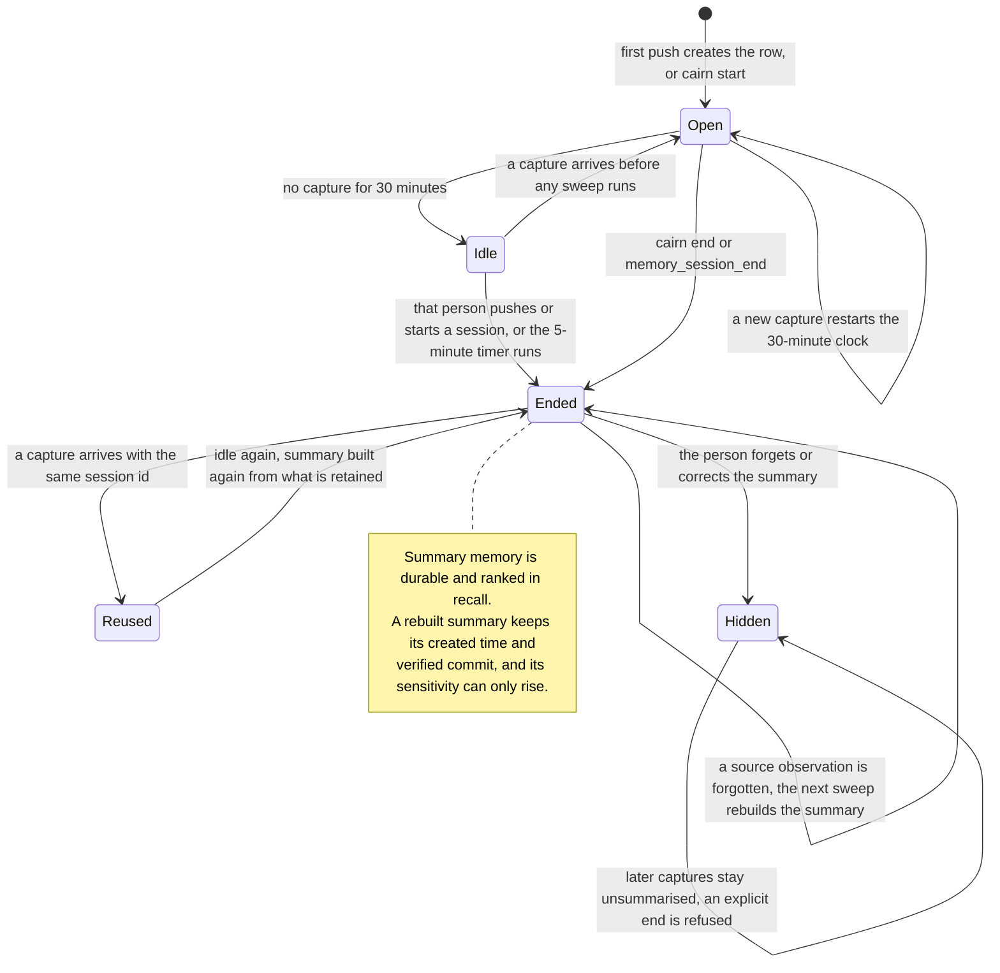

A session with no retained observations gets no summary: an explicit end returns an error, the file store's sweep skips it, and PostgreSQL logs the failure and tries again after another idle period.

Where in the code: `crates/core/src/lib.rs` (`finish_idle_sessions`, `session_needs_summary`, `finish_session_staged`, `carry_summary_state`), `crates/storage/src/lib.rs` (`finish_idle_session`, `finish_session_summary`, `pending_since`).

### 2.4 A queued event's life

An event enters the outbox only when the one POST failed in a way that may pass (no connection, timeout, `408`, `429`, `5xx`). The hook's own pass after a good capture is "bounded"; `cairn_outbox.py replay` is the explicit pass. Other commands are `enqueue`, `status`, and `purge`.

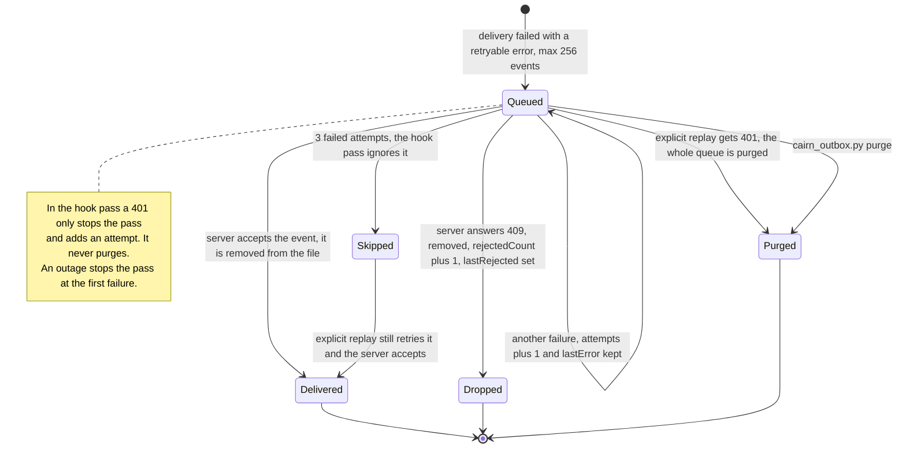

The queue file is bound to one server origin and one device token. A different origin, a rotated token, or a version mismatch makes the hook fail before it sends anything and leave the file untouched; there is no rebind command. `status` prints `pending`, `attempts`, `hasErrors`, `rejectedCount`, and `lastRejected`.

Where in the code: `scripts/cairn_outbox.py` (`_replay_loaded`, `replay_bounded`, `MAX_EVENTS`, `MAX_BOUNDED_ATTEMPTS`, `status`, `purge`), `scripts/cairn_hook.py` (`REPLAY_LIMIT`, `REPLAY_BUDGET`, `_enqueue`). Rules: [hook](./contracts/hook-v1.md#opportunistic-replay), [sync](./contracts/sync-layer3.md).

### 2.5 What is not captured

- Hook events that `examples/claude-code-hooks.json` does not register: `SessionStart` (the examples README says it can be added; it would record only the start input), and any other Claude Code event, such as tool calls before they run, notifications, or subagent and compaction events.
- Tools outside the `PostToolUse` matcher. Only `Bash`, `Edit`, `Write`, and `MultiEdit` are captured; reads, searches, web fetches, MCP tools, and the rest are not, unless you widen the matcher.
- Tool calls that fail may not fire `PostToolUse` at all (Claude Code reference, not checked here).
- Anything while the server is down and `CAIRN_OUTBOX` is unset, a full outbox (256), or a request refused with `401`, `409`, or another `4xx`.
- Project and branch outside a git checkout. The hook derives repository and branch from `cwd` with `git`, so captures from inside a checkout register the project and branch (checked against the file store). When `cwd` is not a git repository, or `git` is not installed, `context` stays empty and nothing is registered. A hook push that creates the session row stores the pushed context there (and fills an empty row, never replacing a real context), so the summary gets the repository and branch scope; a recall filtered by that repository and branch finds it.
- The agent's reasoning and any text that is not a prompt, a final reply, or one of the four tool inputs and outputs.

### 2.6 Setup

The full steps and a one-event check are in [`examples/README.md`](../examples/README.md); the order is:

1. Sign in to the console and open Devices.
2. Create a device for this machine. Copy the token; it is shown once. (Rotate it later from the same page; the old token stops working at once.)
3. Choose an outbox path outside any repository, such as `~/.cairn/outbox.json`.
4. Put `CAIRN_URL`, `CAIRN_DEVICE_TOKEN`, and `CAIRN_OUTBOX` in the `env` block of the Claude Code settings file, or export them in the shell that starts `claude`. The hook reads no config file.
5. Copy the `hooks` block of `examples/claude-code-hooks.json` into `~/.claude/settings.json` (or one project's `.claude/settings.local.json`) and replace the path to this checkout.
6. Run the hook once by hand with a sample event, restart Claude Code, send a prompt, and look for it in `cairn search` or the console.

## 3. Capture path

This is what the server answers to one `sync/push`. The client side (hook, redaction, outbox) is in section 2. The server remembers each event id per person, so a repeat is harmless.

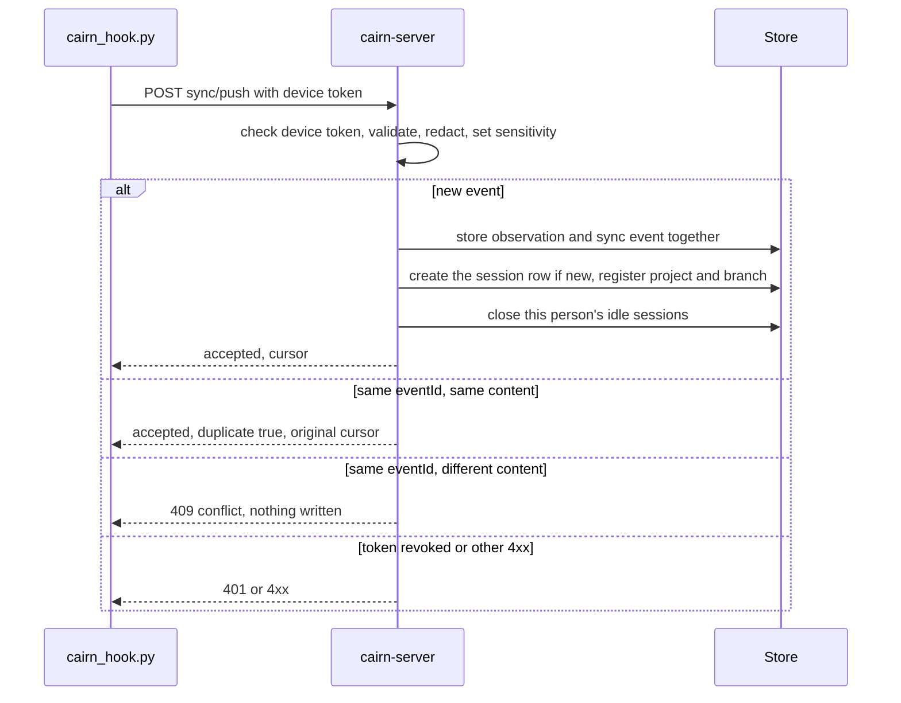

Housekeeping after the write (project registration, idle close) never turns an accepted push into an error. A duplicate push does neither. Both stores now do the same on a new push; the differences that remain:

| Behavior | File store | PostgreSQL |
| --- | --- | --- |
| Project and branch registered from a capture | Yes, on a device push, `cairn capture`, and `memory_observe` | Yes, on every device push |
| Session row created by a hook push | Yes, with the pushed context; an empty row takes the first real one | Yes, with the pushed context; an empty row takes the first real one |
| Idle sessions closed on a push or session start | Yes, per person, at most 16 per run | Yes, per person, at most 16 per run |
| Idle sessions closed by the 5-minute timer | Yes, every person, under the store lock | Yes, every person, oldest pending first, at most 16 per run |
| Pull page size | Everything | 512 events and 512 deletions per call |
| Search ranking | Count of query-term occurrences | Full-text rank (`ts_rank_cd`) |
| Search result cap | None | 512 matches |
| `observe` with a web session | Accepted | 401 (device token only) |

Where in the code: `crates/core/src/lib.rs` (`sync_push`, `capture_for_account`), `crates/storage/src/lib.rs` (`sync_push`, `auto_register_project`). Rules: [hook](./contracts/hook-v1.md), [sync](./contracts/sync-layer3.md).

## 4. Recall path

An agent asks a question through `cairn context`, `cairn search`, or the MCP tools. The server looks only at that person's memories, drops anything forgotten, expired, or replaced by a live correction, and optionally narrows by session, worktree, branch, or repository. Ranking is plain text matching, not semantic search: the file store counts how often the query words appear, and PostgreSQL uses its full-text rank. The answer says how many matches were left out.

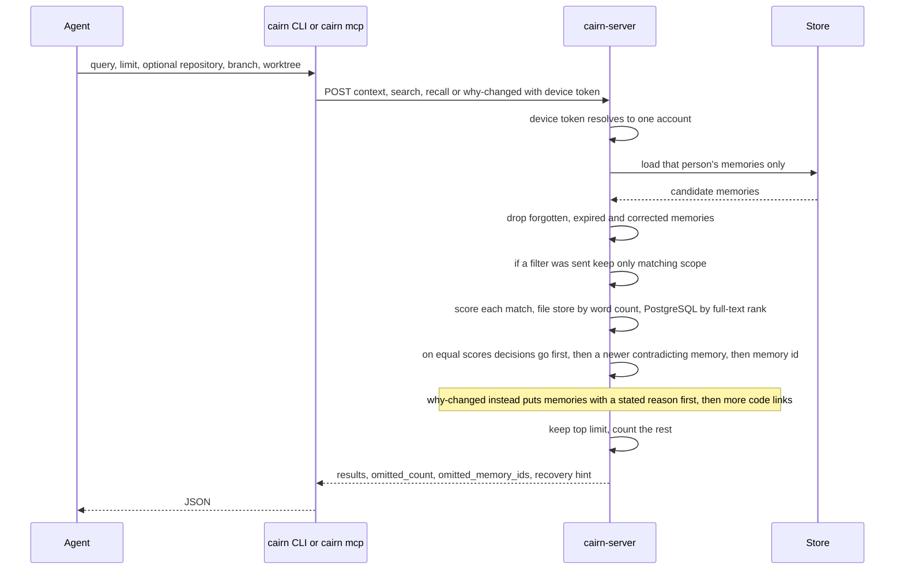

Equal scores are the only place the order is adjusted: a project decision comes before any other memory, then, between two equal memories that list each other as contradictions, the newer one first, and otherwise memory id order. A higher score always wins. Nothing is hidden or resolved by this. Semantic (embedding) search is not implemented.

Scope filter in one line: `worktree` matches repository, branch, and worktree; `branch` matches repository and branch; `project` matches repository; `global` always matches; `session` matches the same session id. With no filter, every scope is returned. A missing field never widens a match. `recall` is the same route as `context`, and `smart-search` is the same route as `search`.

Where in the code: `crates/core/src/lib.rs` (`ranked_matches`, `memory_matches_filter`, `prefer_decision`, `prefer_newer_contradiction`, `build_context_pack`, `why_changed_context`), `crates/storage/src/lib.rs` (`search_window`, `why_changed_context`), `crates/client/src/tools.rs`. Rules: [continuity](./contracts/continuity-v1.md).

## 5. Project flow

Projects appear on their own when a capture carries a repository: any new device push or `cairn capture`, on both stores. (Claude Code sends no repository, so the hook derives it from `cwd` inside a git checkout; see sections 2.1 and 2.5.) Promotion is the only way personal memory becomes project memory, and it makes a copy. The personal memory is never changed or deleted by anything done to the project copy. The owner can do all of the following from the project page in the console, under "Project controls"; the CLI and MCP cover only promote.

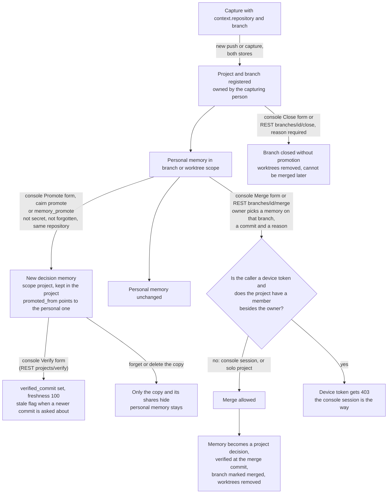

Every merge, close, verify, and promote form asks for confirmation (merge and close show what cannot be undone) and needs a reason or commit where the diagram says so. These actions are owner-only: members see shared decisions but no controls. A merged branch cannot be closed and a closed branch cannot be merged. The `projects/{id}/confirm` route, entity registration, and worktree registration have no console control, CLI command, or MCP tool.

Where in the code: `crates/core/src/lib.rs` (`auto_register_project`, `promote_memory`, `verify_project_memory`, `confirm_branch_merge`, `close_branch`), `crates/storage/src/lib.rs` (same names), `crates/server/src/lib.rs` (routes), `apps/web/components/project-owner-actions.tsx` (console forms). Rules: [project](./contracts/project-layer4.md).

## 6. Sharing flow

Sharing is by invitation. The owner invites an existing account (created by the admin, section 7), then shares one decision at a time, or turns on a policy that shares non-sensitive decisions automatically when they are promoted. The project page shows the current policy, Manual or Automatic, and offers a button to switch to the other. A member reads only what was shared with them.

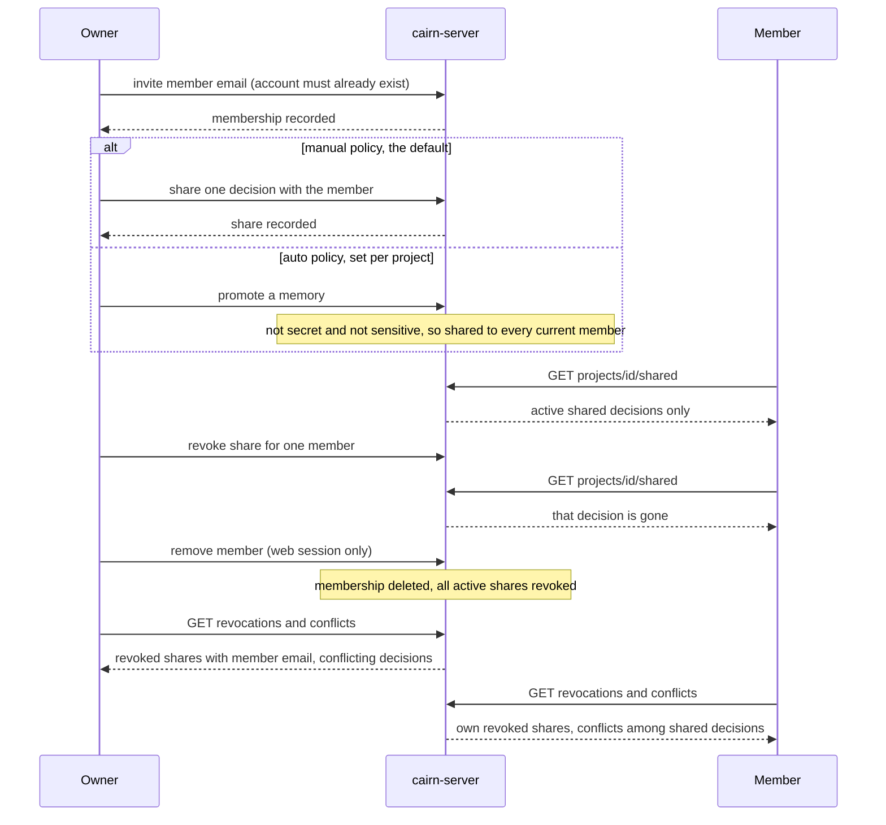

Not shown because it does not exist: a share never copies the memory into the member's own memories, and it does not reach the member's devices through sync. The member's search and context do not return the owner's unshared memories. Turning the policy back to manual does not revoke shares already made. Decisions that a live correction replaced, forgotten, expired, and revoked ones are all hidden from the member.

The console lets an owner invite, share, revoke, delete, create a team, add or remove a member, and switch the share policy (with a confirmation that says what changes). Dismissing a share candidate has no console control, CLI command, or MCP tool; it is REST only. The policy has no CLI command or MCP tool either.

Where in the code: `crates/core/src/lib.rs` (`invite_project_member`, `share_project_memory`, `shared_project_memories`, `revoke_project_share`, `remove_project_team_member`, `auto_share_new_project_memory`, `project_revocations`), `apps/web/components/project-detail.tsx`, `apps/web/components/project-owner-actions.tsx`. Rules: [share](./contracts/share-layer5.md).

## 7. Sign-in, tokens, and permissions

The first visitor to an empty server creates the first account, and that account is the only admin. There is no open sign-up: every later account is created by the admin on the console's Accounts page. The console then creates device tokens, shows each one once, and stores only a hash. An agent gets its token through `cairn setup`, which reads it from standard input so it never lands in shell history. A device token can do almost everything an agent needs, but it is refused with `403` for account and device management, member removal, and merging on a shared project.

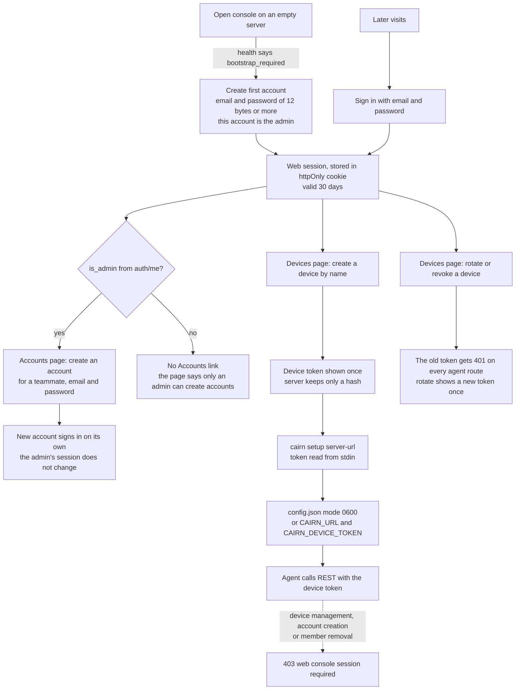

Hooks do not read `config.json`; they need `CAIRN_DEVICE_TOKEN` (and optionally `CAIRN_URL`) in their environment. Sign-in sessions last 30 days, on the server and in the console's cookie. Bootstrap, register, and login are limited to 10 tries per minute per email.

`GET auth/me` returns the signed-in account with `is_admin` for a web session or a device token; the console uses it to show or hide the Accounts link. There is exactly one admin and no way to change that role through the API. Creating an account (`POST auth/register`) answers:

| Caller | Answer |
| --- | --- |
| No bearer, or an unknown, expired, or revoked one | `401` |
| A device token, even the admin's own | `403`, web console session required |
| A web session of a non-admin account | `403`, only the admin account can do this |
| The admin's web session | `200`, a new account; the console drops the new account's session token and keeps the admin's |

The admin check runs before the per-email rate limit and before the email and password are validated. A duplicate email, or an email or password that fails validation, answers `400`.

| Action | Web session | Device token |
| --- | --- | --- |
| Create the first account, sign in | Yes, no bearer needed | `403` (bootstrap and login refuse a device bearer) |
| Create another account | Admin only; any other account `403` | `403` |
| Sign out, read audit history | Yes | `403` |
| Create, list, rotate, revoke devices | Yes | `403` |
| Remove a team member | Yes | `403` |
| Merge a branch on a project that has other members | Yes (owner) | `403` |
| Merge a branch on a solo project | Yes (owner) | Yes |
| Who am I (`auth/me`) | Yes | Yes |
| Start or end a session | Yes | Yes |
| Capture through `sync/push`, pull, sync diagnose | `401` | Yes |
| Recall, search, resume, why-changed, diagnose | Yes | Yes |
| Remember, correct, forget, delete, export, import | Yes | Yes |
| Projects, promote, verify, branches, invite, share, revoke, policy, teams | Yes | Yes |

Where in the code: `crates/core/src/lib.rs` (`bootstrap_account`, `register_account_as_admin`, `authenticate_admin`, `authenticate_session`, `authenticate_account`, `WEB_ONLY_ERROR`, `ADMIN_ONLY_ERROR`, `AUTH_SESSION_SECONDS`, `confirm_branch_merge`), `crates/storage/src/lib.rs`, `crates/server/src/lib.rs` (`auth_register`, `auth_me`, `AUTH_ATTEMPT_LIMIT`), `migrations/0013_admin_role.sql`, `apps/web/app/api/cairn/[...path]/route.ts` (cookie), `apps/web/components/login-form.tsx`, `accounts.tsx`, `devices.tsx`, `apps/web/hooks/use-account.ts`, `crates/client/src/lib.rs`. Rules: [auth](./contracts/auth-layer3.md), [ADR 0008](./adr/0008-self-hosted-account-authentication.md).

## 8. Sync between devices

Every accepted capture gets a cursor number in that person's stream. A device asks for everything after the cursor it last saw and gets new events plus deletion instructions. The server hands out cursors one person at a time, in order, so a pull never skips an item that is still being written. Two devices do not merge or resolve content: a conflict is only the same event id arriving with different content, and that is refused with `409`.

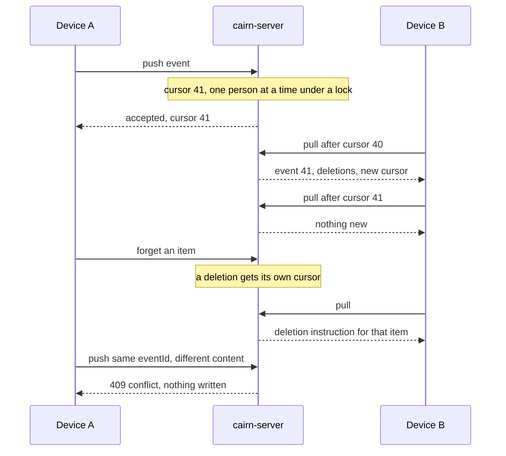

Pull and sync diagnose are REST routes that only the smoke scripts call. No shipped client reads the sync stream: the hook only pushes, and `cairn` and `cairn mcp` ask the server directly (search, context, resume) every time. A deletion instruction is therefore never delivered to anything today, and that is fine, because no client keeps a local copy of memory that could go stale. The only local data on a device is the outbox, which holds events that were never delivered, so the server has nothing to forget for them yet. A forget or delete takes effect at the server, and the next recall already leaves the item out. The pull route and its deletion instructions are the hook for a future client that keeps a local cache; such a client would have to pull to learn about deletions. Sync diagnose always reports `pending_events` and `rejected_events` as `0`; the outbox's own `status` reports its queue and rejected count.

Where in the code: `crates/core/src/lib.rs` (`sync_push`, `sync_pull`), `crates/storage/src/lib.rs` (`sync_pull`, `lock_sync_cursor`, `MAX_PULL_EVENTS`), `scripts/smoke_layer3.sh`. Rules: [sync](./contracts/sync-layer3.md).

## 9. Use cases

Mermaid has no use-case diagram type, so each case is a flowchart: a person on the left, the steps they or their agent take on the right.

### 9a. A solo developer's day with an AI agent

Nothing in the day needs a manual save. The one deliberate act is asking for context at the start.

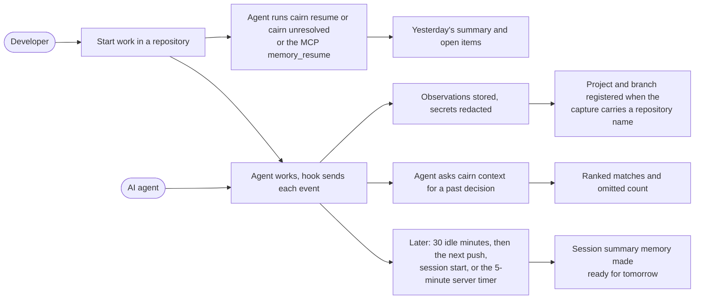

### 9b. A team owner shares decisions with a member

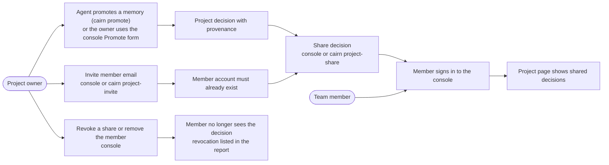

### 9c. Setting up a new device or agent

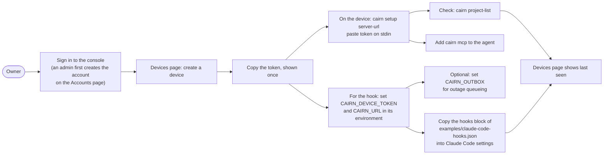

### 9d. Correcting or forgetting a wrong memory

Pick the action by what is wrong. A correction keeps history; forget hides and keeps the record; a project delete only touches the project copy.

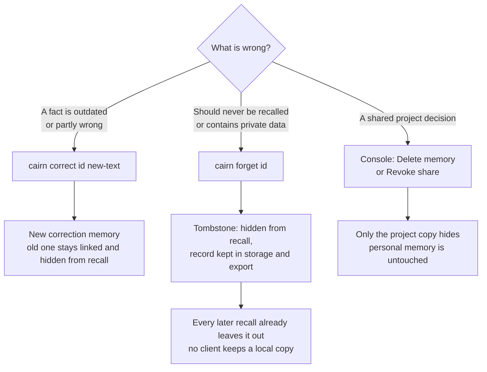

### 9e. The reports the owner looks at in the console

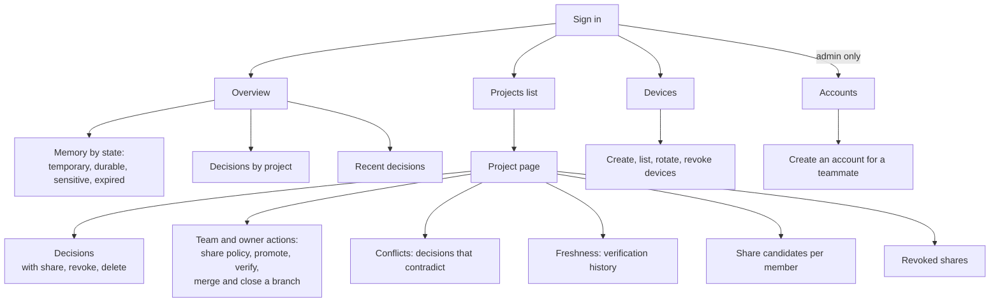

### 9f. The admin adds a teammate

The teammate's account must exist before the owner can invite them to a project (section 6). Only the admin can create it.

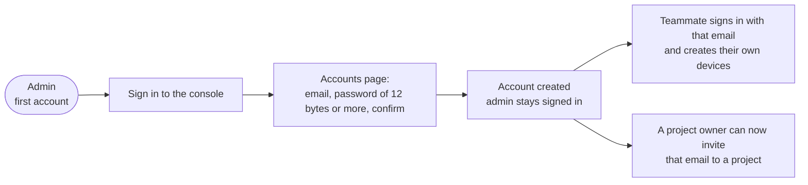

Where in the code: `apps/web/components/overview.tsx`, `project-detail.tsx`, `project-owner-actions.tsx`, `project-reports.tsx`, `devices.tsx`, `accounts.tsx`, `crates/client/src/bin/cairn.rs`.

## 10. Tools at a glance

| Tool | What it is for | Who uses it | Credential |
| --- | --- | --- | --- |
| `scripts/cairn_hook.py` | Turns one agent event (Claude Code hook input, section 2.1) into a `sync/push`; optional outbox on outage | The agent host, automatically | `CAIRN_DEVICE_TOKEN` (env), `CAIRN_URL` (env) |
| `scripts/cairn_outbox.py` | Manual queue control: `enqueue`, `replay`, `status`, `purge` | An operator or script | Device token via `--token` (replay only) |
| `cairn` CLI | One REST call per command. `setup`, `mcp`, `start`, `capture`, `end`, `search`, `context`, `why-changed`, `resume`, `unresolved`, `forget`, `lesson`, `correct`, `export`, `import`, `project-register`, `project-list`, `promote`, `project-memories`, `project-freshness`, `project-invite`, `project-share`, `project-shared`, `project-revoke`, `project-team-create`, `project-team`, `project-team-add`, `delete-memory` | Agents, and people setting up | Device token from `cairn setup` or env |
| `cairn mcp` | Same tool table over MCP stdio. 32 tools; the 26 that match a CLI command are in the CLI row, and six are MCP only: `memory_save`, `memory_recall`, `memory_consolidate`, `memory_smart_search`, `memory_diagnose`, `memory_reflect` | AI agents | Device token |
| Web console | Pages: sign-in (`/` and `/login`), `/dashboard`, `/projects`, `/projects/[id]` (owner controls: share policy, promote, verify, merge, close), `/devices` (create, rotate, revoke), `/accounts` (admin only, linked from the sidebar only when `auth/me` says `is_admin`) | The owner, invited members, and the admin | Web session cookie |
| REST server | `cairn-server`, routes under `/cairn-memory/*`, plus `/viewer` | Everything above | Per route: web session, device token, or both |
| Docker dev stack | PostgreSQL 16, server, console on 127.0.0.1 ports 55432, 58080, 53000; `scripts/dev_up.sh` and `scripts/dev_down.sh` | Developers of Cairn | A generated database password in `.env.dev` |

Actions with no CLI command, MCP tool, or console control today (REST only): `projects/{id}/confirm`, dismissing a share candidate, entity registration, and worktree registration. Branch merge and close, verify, share policy, and device rotate have console forms but still no CLI command or MCP tool; account creation is console only by design. Semantic (embedding) search is not implemented; the health route reports `semantic_search: disabled`.

Where in the code: `crates/client/src/tools.rs` (tool table), `crates/client/src/bin/cairn.rs` (commands), `crates/server/src/lib.rs` (routes), `apps/web/components/app-sidebar.tsx` (pages), `examples/claude-code-hooks.json`, `docker-compose.dev.yml`.
