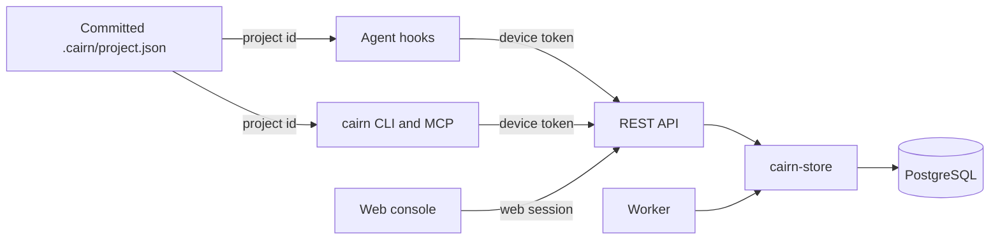
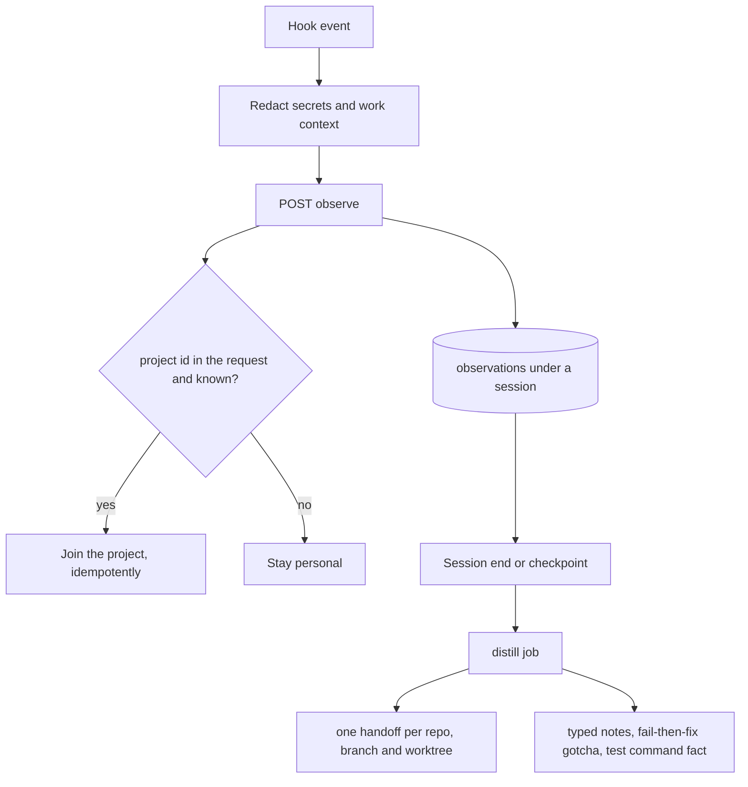
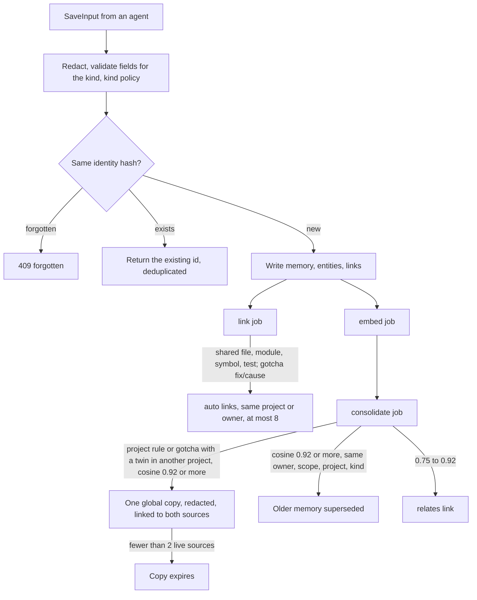
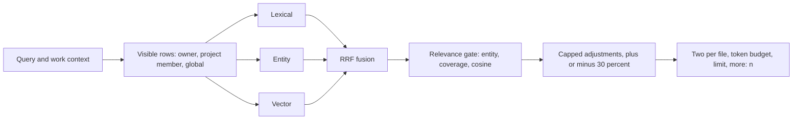

# Cairn Memory Data Flow Guide

This guide shows how data moves through the 0.1.6 server. Structure and tables are in
[architecture](architecture.md); exact route and field behavior is in the
[0.1.6 specification](specs/0.1.6-foundation.md) and the [contracts](contracts/project-layer4.md).

## System map

The server URL stays outside the committed file. Account creation is an admin operation; people create
device tokens in the web console. A device token can use the agent routes but not account, device or
ownership routes. A password reset revokes web sessions, not device tokens.

## Capture and distill

Capture is always personal. A failed project attachment never fails the capture; the reply carries
`project_attachment.status` (`attached` or `personal`). Event ids are stable: an identical replay is
acknowledged and a changed replay is a conflict. The hook keeps a bounded outbox for outages. Observations
are raw evidence and are never recalled directly; they expire and are swept, and are deleted a week after their
session is distilled. At session start the hook also answers the brief's `check` (which cited files and symbols still
exist on the default branch, which branches are merged) with `POST /session/repo-state`, which marks memories stale or
active again and moves merged-branch memories to the default branch.

## Save

The default scope of a decision, rule, gotcha, procedure or fact is `project` in an initialized
repository and `personal` otherwise; a preference is always `personal`. A correction is a new save with
`supersedes`; the old memory stays as history. A quarantined job is retried once at the first start after a server
upgrade, then by the sweep a day later, with one attempt left, so nobody requeues jobs by hand.

## Recall

One ranking serves personal, project and global memories; the visibility rule runs in the same query before
any id leaves the store (for the vector channel, inside the HNSW index scan). `kind=handoff` on `/search` finds the caller's own handoffs.
The session brief is this branch's last handoff, the project's rules, decisions and gotchas ranked by the
session's recent files, branch and feedback, and two personal preferences, at most 1,200 bytes.

## Projects and console

`cairn init` creates the project (the caller becomes the owner) and writes `.cairn/project.json`; commit it.
**Possessing the id is enough to join:** anyone with an account on the server and a copied id can read the
project's memories and the member emails. There are no invites and no member removal. The owner can rename
the project and transfer ownership; the previous owner stays a member.

The console shows memories, a graph of memories and links, projects with their members, derived branch
lists and conflicts (read-only), background jobs, devices and accounts. Forgetting is the only delete:
it erases the text and keeps the identity hash so the same memory cannot silently return.
