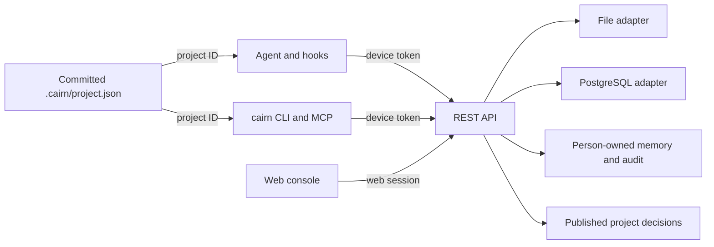
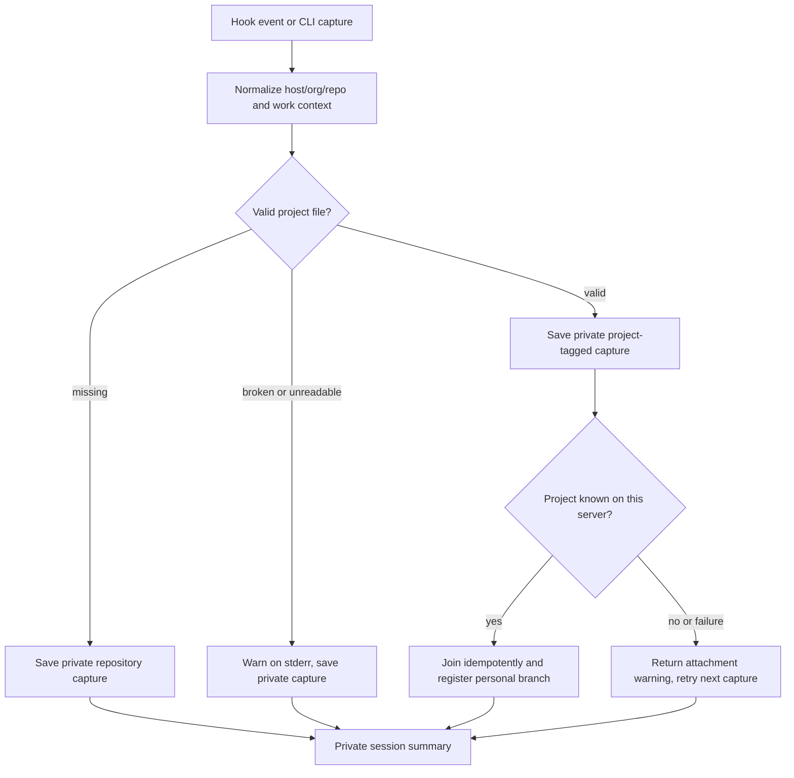
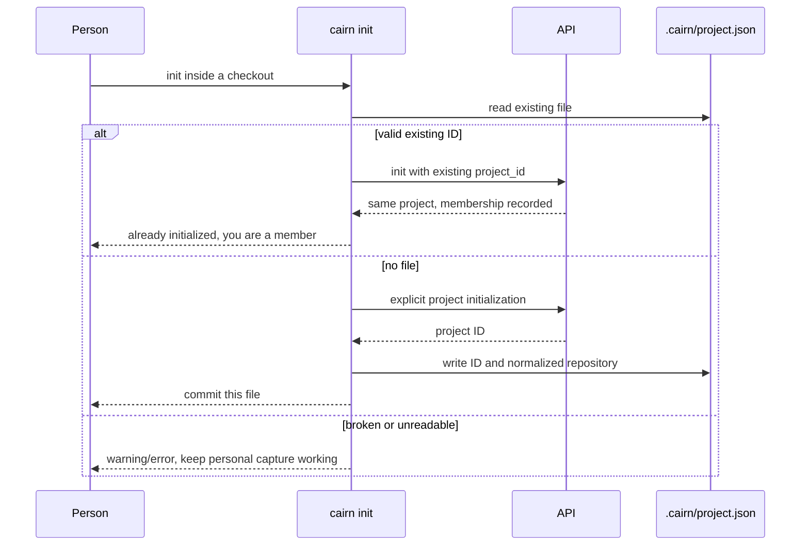
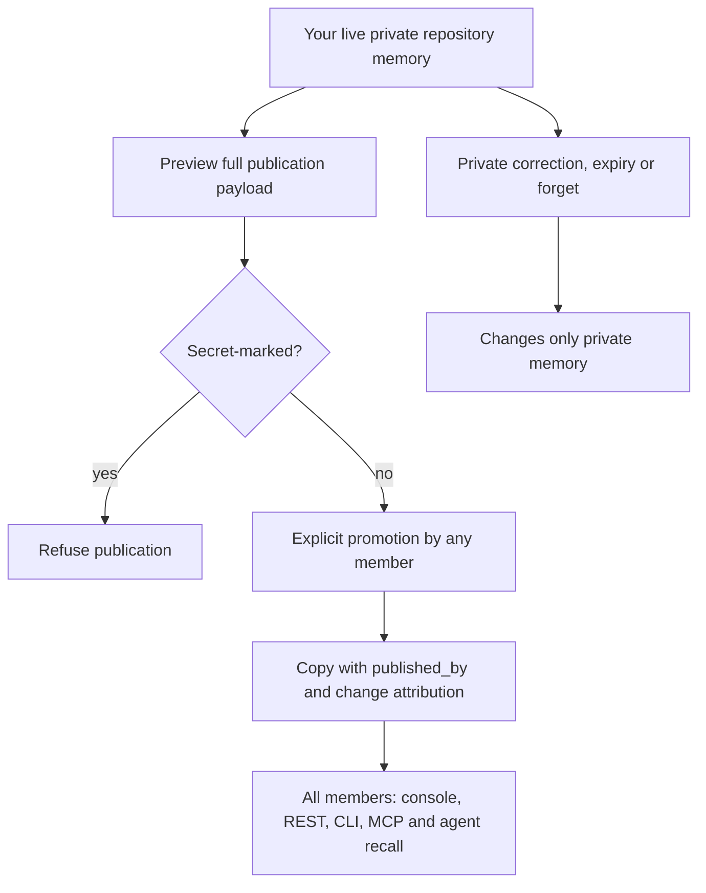
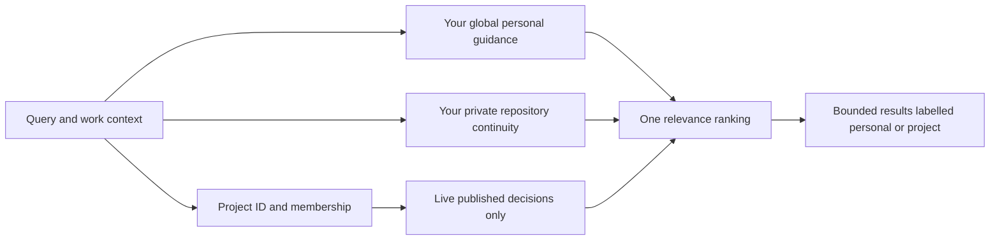

# Cairn Memory Data Flow Guide

This guide explains the shared project model. The exact behaviors belong to
[the project contract](contracts/project-layer4.md) and
[ADR 0013](adr/0013-shared-project-decisions-and-personal-memory-scopes.md).

## System map

The server URL stays outside the committed file. Account creation is an admin
operation; people provision device credentials in the web console. Devices can
use agent routes but cannot manage accounts/devices or transfer project ownership.
Password reset/change revokes web sessions, not device tokens. Device revocation
is a separate action on Devices.

## Capture stays personal

There is no per-person private project auto-registration. A repository name alone
never creates a project. Attachment failure does not turn an accepted personal
capture into a failed capture. `project_attachment` reports `attached` or `personal`
and an optional warning; even duplicate replays retry failed attachment.

Hooks derive SSH/HTTPS origins as `host/org/repo`, lowercase the host and strip
`.git`. Without a network remote they use `local:<directory>`. Explicit supplied
context stays authoritative. Prompts, tool results and summaries remain private.
Global personal guidance is an explicit memory/lesson without repository context;
repository-tagged explicit memories stay private to that repository.

Hooks redact before transport and optional outbox writes. Event IDs remain stable;
identical replay is acknowledged and changed replay is a conflict. The bounded
outbox handles outages without creating a second source of truth. See
[hook capture](contracts/hook-v1.md), [sync](contracts/sync-layer3.md) and
[lifecycle](contracts/lifecycle-v1.md) for limits, redaction and retry rules.

## Initialize and join

**ID possession is enough to join.** Anyone with an account on that server and a
copied/leaked ID can read every decision and member email. Cairn does not prove
SCM access. Removing Git access or the file does not revoke membership. There are
no invites or member removal. Ownerless legacy projects are unsupported.

## Publish a decision

The copy shares full content and metadata. It clears private event/session
provenance and branch/worktree context, keeping verification evidence. Preview is
read-only; generated publication IDs and timestamps are allocated per request.
The web dialog displays the full payload, and CLI/MCP offer a dry run.

A `project_id` on a private row, capture or imported memory is not publication
proof. Only publication transitions set `published_by`. The author and current
owner may verify, correct and delete the copy. Others read only. Corrections are
project-visible and preserve original authorship with `changed_by`/`changed_at`.
Deleting a publication retains the record and never cascades to its private source.

Private source correction/forget never hides a decision. Explicitly promoting a
corrected source can supersede an earlier decision. A live successor hides its
predecessor; forgetting/expiring it can reveal the predecessor again. Lists,
recall and maintenance share this eligibility rule.

## One recall ranking

Project decisions match IDs, never short repository names. Another person's
personal rows do not enter ranking, contradictions, omitted-result IDs or context.
Existing branch/worktree relevance filters still apply to personal continuity.
Resume and unresolved-work stay personal. PostgreSQL's 512-row result window and
its omission reporting remain; published decisions require online retrieval.

## Governance and console

The project page has Decisions, Memories and Members. Everyone sees the same live
decisions, their own live repository memories, and the email roster with an owner
badge. Decision row actions appear only for the author or owner. Memories offers
Promote with full preview. Members offers owner transfer to the owner/admin.
An admin can also transfer from Accounts. Transfer is audited, the previous owner
stays a member, and private memory/branch ownership stays with its person.
Audit history itself stays private; decision attribution is project-visible.

Branches and worktrees are personal bookkeeping. Two members can record the same
branch name independently. "Record merge" publishes the caller's chosen evidence
and changes only their branch/worktrees. Devices can record merges on projects
with members; the old member-count gate is gone. Close records abandonment without
publishing. The embedded viewer has no project actions and points to the console.

There are no selective grants, share/revoke controls, manual/automatic policies,
dismissals, separate shared-list paths or team spaces. The member list is the roster.

## Sync, backup and recovery

Personal device sync transports only that person's events and deletion instructions.
It is not a project decision feed. Membership does not copy other people's personal
captures into a device or export. Personal export excludes publications and does
not back up project identity, roster or governance. Import clears publication
state and restores personal memory; publication always needs explicit promotion.

Ownership transfer provides continuity when an owner leaves. Admin recovery is
trusted, with audit attribution. There is no account/project deletion workflow in
this model and no migration of old development project data. See
[export](contracts/export-v1.md), [authentication](contracts/auth-layer3.md), and
[project operations](contracts/project-layer4.md) for the current routes.
